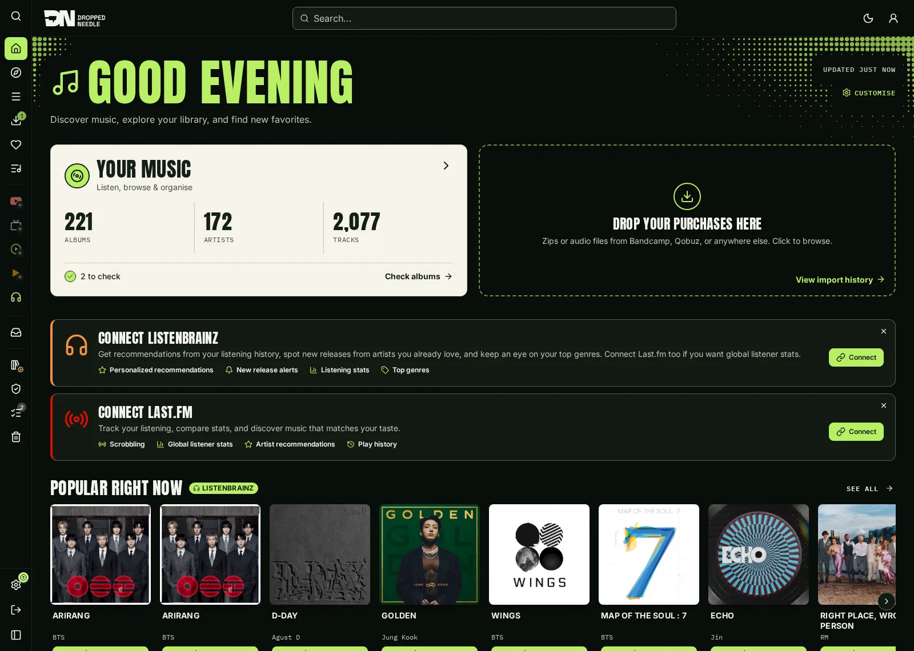
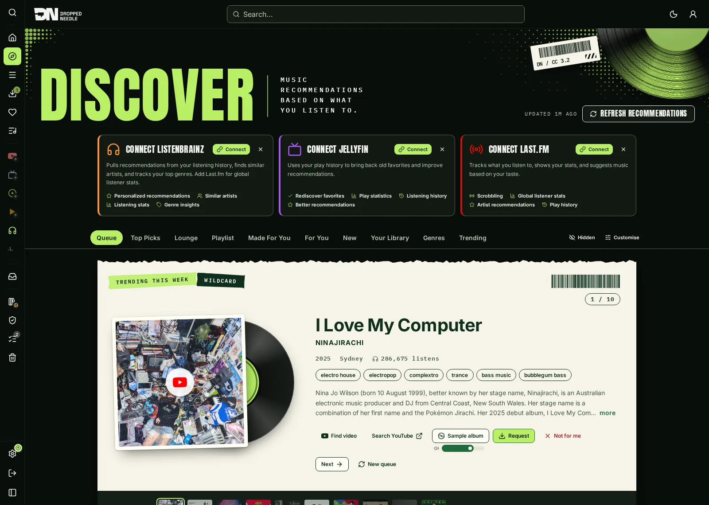
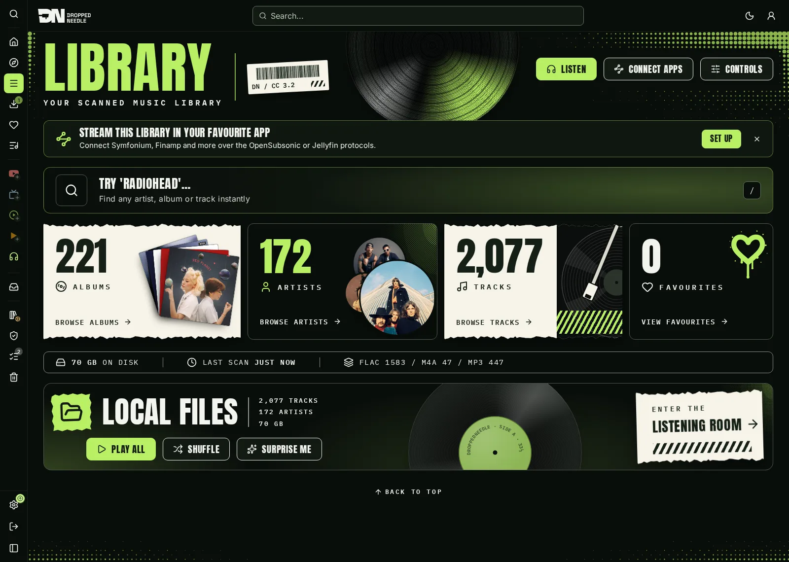
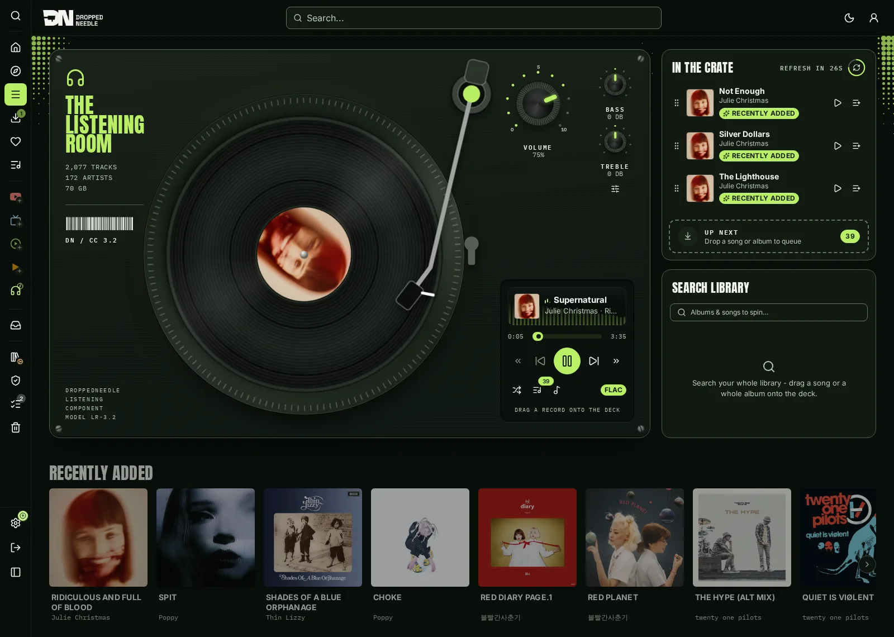
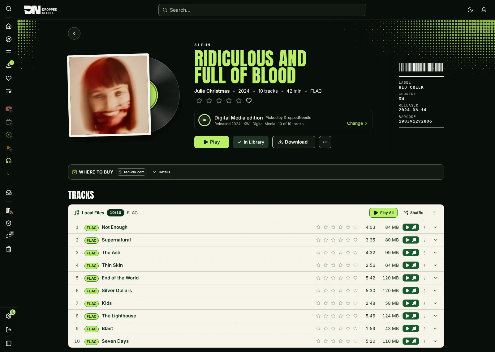
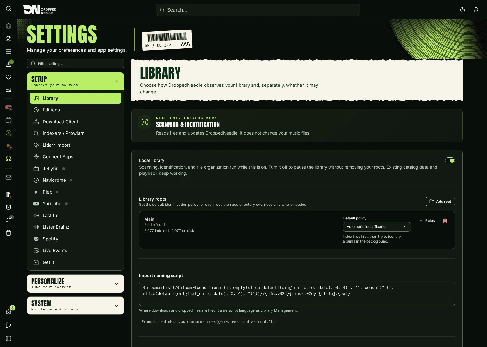
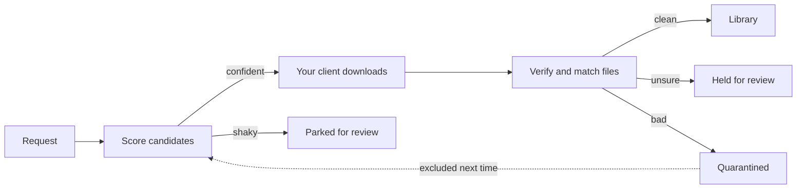

<div align="center">


**Request music. Own everything.**

DroppedNeedle is a self-hosted music request and discovery app for you and the people you share a server with. Search MusicBrainz, request an album or a single track, and it fetches it through your own slskd or SABnzbd, checks every file and files it in your library. Then play it in the browser, or in Symfonium, Finamp, Feishin and other Subsonic or Jellyfin apps.

One container. No Lidarr.

[](https://github.com/DroppedNeedle/DroppedNeedle/actions/workflows/v3-ci.yml)
[](LICENSE)
[](https://github.com/DroppedNeedle/DroppedNeedle)
[](https://hub.docker.com/r/droppedneedle/droppedneedle)
[](https://discord.gg/B5suDg7gu2)
[](docs/README.md)

[Docs](docs/README.md) | [Website](https://www.droppedneedle.com/) | [Discord](https://discord.gg/B5suDg7gu2) | [Issues](https://github.com/DroppedNeedle/DroppedNeedle/issues) | [Sponsor](https://github.com/sponsors/HabiRabbu)

</div>

---



<details>
<summary>More screenshots</summary>







</details>

> [!NOTE]
> DroppedNeedle only drives a download client you run yourself. It never joins a P2P network, ships no indexers and hosts no audio. What you fetch, and what your client shares, is your call and your responsibility.

## What it does

- **Requests** for whole albums or single tracks from the MusicBrainz catalog, with an approval queue for the User role.
- **Downloads** through your slskd, your SABnzbd with Newznab indexers or Prowlarr, or a plugin. It scores the candidates, verifies every file and holds what it isn't sure of.
- **Wanted and upgrades**: failed and partial requests are searched again until a verified copy shows up, and a better copy replaces a worse one.
- **Your library**, scanned and identified against MusicBrainz and AcoustID without renaming or retagging anything. Browse, search, rate and play it.
- **Library Management**, off until you turn it on: Picard-style tags, artwork and file naming behind a preview, with undo.
- **Drop imports** for music you bought elsewhere: drag in a zip or loose files.
- **Discovery**: trending, charts, genres, recommendations from ListenBrainz or Last.fm, a discover queue, a weekly mix, new releases from artists you follow, and gig alerts for your cities.
- **A web player** with a queue, a 10-band EQ, lyrics and live now-playing.
- **Playlists** mixing your library, Jellyfin, Navidrome, Plex, YouTube and Spotify imports.
- **Plugins** for more download sources, scrobble targets and purchase links.

Every feature, one line each: [docs/features.md](docs/features.md).

How a request moves:



The engine searches your client, ranks candidates, and accepts a confident match by itself. Close calls wait for review instead of guessing.

## Quick start

You need Docker, a music library, and a download client. The example below uses slskd; [SABnzbd](https://sabnzbd.org/) with Newznab indexers or Prowlarr works too. DroppedNeedle runs neither for you: see [Download clients](docs/download-clients.md).

**1. Save this compose file.** Images are on [Docker Hub](https://hub.docker.com/r/droppedneedle/droppedneedle) as `droppedneedle/droppedneedle`.

```yaml
services:
  droppedneedle:
    image: droppedneedle/droppedneedle:latest
    container_name: droppedneedle
    environment:
      - PUID=1000            # run `id` on your host to find your user/group ID
      - PGID=1000
      - UMASK=027            # secure default; 002 for trusted group-writable media
      - PORT=8688
      - TZ=Etc/UTC           # e.g. Europe/London, America/New_York
      - SLSKD_DOWNLOADS_PATH=/data/slskd/complete
    ports:
      - "8688:8688"
    volumes:
      - ./config:/app/config
      - ./cache:/app/cache
      - ./plugins:/app/plugins  # omit and installed plugins vanish on recreate
      - ./imports:/app/imports  # uploads waiting for a match; omit and they vanish on recreate
      # One shared parent mount keeps the library and completed downloads on one
      # boundary so imports move fast. Do not nest extra binds under /data.
      - /path/to/media:/data:rw
    restart: unless-stopped
```

The full annotated compose, with an optional slskd sidecar, is [docker-compose.example.yml](docker-compose.example.yml). Every environment variable is in [Configuration](docs/configuration.md).

**2. Start it.**

```bash
docker compose up -d
```

Then open [http://localhost:8688](http://localhost:8688).

**3. First run.**

1. Create the first admin account. This happens once.
2. Add your library path under Settings > Library, using the in-container path (e.g. `/data/music`).
3. Add your download client under Settings > Download Client, then Test and Save.
4. Press Scan for changes on Settings > Library. The scan reads and identifies files without renaming or retagging anything.
5. Search the catalog, open an album, and Request it. Watch it land live on the Downloads page.

Bringing in a collection you want filed and tagged? See [Bringing in an existing library](docs/downloads.md#bringing-in-an-existing-library).

To update, run `docker compose pull` and `docker compose up -d`. DroppedNeedle backs up its database before a new version changes it: see [Backups and restore](docs/backups-and-restore.md).

## Coming from v2

Stop v2, switch the image to `:latest` (or a version such as `:v3.0.0`) and start it. It serves an upgrade page that checks first, upgrades your data in place and keeps your v2 files so you can go back.
Callback addresses for single sign-on, Spotify playlist import and MusicBrainz contributions change, and v2 plugins need porting.
Follow [Upgrading from v2](docs/upgrading-from-v2.md), and read [What changed in v3](docs/v3-changes.md) first.

## Works with your apps

- **Music apps.** DroppedNeedle answers the OpenSubsonic and Jellyfin APIs, so Subsonic apps (Symfonium, Feishin, Arpeggi) and Jellyfin apps (Finamp, Jellify, Manet) can play your library. [Connect your music app](docs/connect-your-app.md) says what to enter.
- **Media servers.** It plays from Jellyfin, Navidrome, Plex or local files, and reports plays back to your own account there.
- **Scrobbling.** ListenBrainz and Last.fm, per user.
- **Sign-in.** Single sign-on through any OpenID Connect provider, and sign-in with Plex or Jellyfin: see [Accounts and sign-in](docs/accounts-and-sign-in.md).

## Docs

- [Configuration](docs/configuration.md): environment variables, folders, permissions, where each setting lives, updating.
- [Download clients](docs/download-clients.md): slskd, SABnzbd and drop imports.
- [Accounts and sign-in](docs/accounts-and-sign-in.md): roles, single sign-on, Plex and Jellyfin sign-in, recovery.
- [Connect your music app](docs/connect-your-app.md): Subsonic and Jellyfin apps.
- [Your library](docs/library.md) and [Library Management](docs/library-management.md).
- [Requests and downloads](docs/downloads.md) and [Discovery](docs/discovery.md).
- [Reverse proxy and security](docs/reverse-proxy-and-security.md) and [Backups and restore](docs/backups-and-restore.md).
- [Troubleshooting](docs/troubleshooting.md).
- [Plugins](PLUGINS.md) and [Writing a plugin](docs/writing-a-plugin.md).

The full list is in [docs/README.md](docs/README.md).

## Contributing

Bug reports and feature requests go to [Issues](https://github.com/DroppedNeedle/DroppedNeedle/issues), code to pull requests. Dev setup, tests and style rules are in [CONTRIBUTING.md](CONTRIBUTING.md). AI-assisted contributions are welcome: see [Using AI](CONTRIBUTING.md#using-ai).

## Support and license

Chat: [Discord](https://discord.gg/B5suDg7gu2). Bugs and ideas: [GitHub Issues](https://github.com/DroppedNeedle/DroppedNeedle/issues).

<div align="center">

[](https://ko-fi.com/M4M41URGJO)
[](https://github.com/sponsors/HabiRabbu)

If DroppedNeedle earns its keep, fuel it. Monthly or one-off, both welcome.

</div>

DroppedNeedle is [AGPL-3.0](LICENSE). Copyright (c) 2025 DroppedNeedle and contributors. For commercial licensing, write to contact@droppedneedle.com.

The Docker image bundles [FFmpeg](https://ffmpeg.org) under the LGPL, built with libmp3lame and libopus, to transcode FLAC, MP3, Ogg Vorbis, Opus, AAC, ALAC and WAV. Its license files, configure line and source are in `/usr/share/doc/ffmpeg/` inside the image, and libmp3lame's Debian source is in `/usr/share/doc/ffmpeg/lame/`.

The licenses of the Rust crates and web UI packages DroppedNeedle is built from are in `/usr/share/doc/droppedneedle/` inside the image (`NOTICES-server.txt` and `NOTICES-web-ui.txt`), beside DroppedNeedle's own `LICENSE`.
