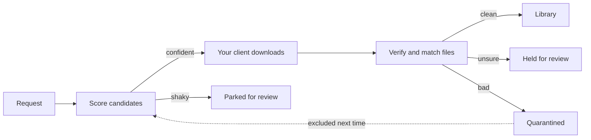

<div align="center">


**Request music. Own everything.**

Self-hosted music requests and discovery with a built-in library and download engine that drives your own clients. No Lidarr. One container.

[](LICENSE)
[](https://github.com/DroppedNeedle/DroppedNeedle)
[](https://hub.docker.com/r/droppedneedle/droppedneedle)
[](https://discord.gg/B5suDg7gu2)
[](https://www.droppedneedle.com/)

[Docs](https://www.droppedneedle.com/) | [Discord](https://discord.gg/B5suDg7gu2) | [Issues](https://github.com/DroppedNeedle/DroppedNeedle/issues) | [Sponsor](https://github.com/sponsors/HabiRabbu)

</div>

---

Search the full MusicBrainz catalogue, request the album or the single track you actually want, and DroppedNeedle takes it from there: it drives your own download client, scores the candidates, verifies every file, and shelves the result in your library. Play it back from Jellyfin, Navidrome, Plex, or local files, or let any Subsonic or Jellyfin app play from you.

> [!NOTE]
> DroppedNeedle only drives a download client you supply and run yourself over its local HTTP API. It never joins a P2P network, ships no indexers, and hosts no audio. What you fetch, and what your client shares back, is your call and your responsibility.

## Contents

- [See it](#see-it)
- [Quick start](#quick-start)
- [What it does](#what-it-does)
- [Download sources](#download-sources)
- [Configuration](#configuration)
- [Troubleshooting](#troubleshooting)
- [For builders](#for-builders)
- [Support and license](#support-and-license)

---

## See it


<details>
<summary>More screenshots</summary>


</details>

---

## Quick start

You need Docker, a music library, and a download client. The example below uses slskd; [SABnzbd](https://sabnzbd.org/) with Newznab indexers or Prowlarr works too. DroppedNeedle runs neither for you. See [slskd](#slskd) and [Usenet](#usenet).

### 1. Save this compose file

Images live on [Docker Hub](https://hub.docker.com/r/droppedneedle/droppedneedle) as `droppedneedle/droppedneedle:latest`.

```yaml
services:
  droppedneedle:
    image: droppedneedle/droppedneedle:latest
    container_name: droppedneedle
    environment:
      - PUID=1000            # run `id` on your host to find your user/group ID
      - PGID=1000
      - UMASK=027            # secure default; 002 for trusted group-writable media
      - PORT=8688
      - TZ=Etc/UTC           # e.g. Europe/London, America/New_York
      - SLSKD_DOWNLOADS_PATH=/data/slskd/complete
    ports:
      - "8688:8688"
    volumes:
      - ./config:/app/config
      - ./cache:/app/cache
      - ./plugins:/app/plugins  # omit and installed plugins vanish on recreate
      # One shared parent mount keeps the library and completed downloads on one
      # boundary so imports move fast. Do not nest extra binds under /data.
      - /path/to/media:/data:rw
    restart: unless-stopped
```

> [!TIP]
> The full annotated compose, including an optional slskd sidecar, is [docker-compose.example.yml](docker-compose.example.yml).

### 2. Start it

```bash
docker compose up -d
```

Then open [http://localhost:8688](http://localhost:8688).

### 3. First run

1. Create the first admin account. This happens once.
2. Add your library path under Settings > Library, using the in-container path (e.g. `/data/music`).
3. Add your download client under Settings > Download Client, then Test and Save.
4. Hit Scan on Settings > Library. The scan reads and identifies files without renaming or retagging anything.
5. Search the catalogue, open an album, and Request it. Watch it land live on the Downloads page.

Settings > Library won't let you remove your last library path while the library still has tracks in it. Set the path to Excluded instead if you want it left alone. If a path disappears from the settings while its tracks are still in the library, the page offers to put it back.

<details>
<summary>Updating and the dev tag</summary>

Update like any other container:

```bash
docker compose pull
docker compose up -d
```

Before a new version changes the database schema, DroppedNeedle writes a verified backup of the database to `/app/cache/backups`. If an upgrade goes wrong, stop the container, delete `library.db-wal` and `library.db-shm` if they exist, put the backup back in place of `/app/cache/library.db`, and run the previous image.

Coming from v2? Follow [docs/upgrading-from-v2.md](docs/upgrading-from-v2.md). Stop v2, switch the image tag to v3, and run `docker compose run --rm droppedneedle droppedneedle-tool upgrade` before you start it. It upgrades your data directory in place and keeps your v2 files in a `v2-backup` folder so you can go back. v3 refuses to start on a v2 data directory that has not been upgraded. The upgrade brings over accounts, settings, linked accounts, follows, playlists, favorites, play history, finished requests and downloads, per-user preferences, and your library as v2 knew it: the same song and album ids (so Subsonic and Jellyfin apps keep their stars and downloads), your manual matches and edition choices, and the originals of files Library Management changed, which "restore original" still brings back. The guide lists exactly what stays behind.

A `:dev` tag (`droppedneedle/droppedneedle:dev`) is built from `main` on every push and may break. Pin a commit with `:dev-<short-sha>`.

Pre-releases are published to the same image under their own version tag, for example `droppedneedle/droppedneedle:v3.1.0-rc.1`. They never move `:latest`, so you only get one by asking for its tag.

</details>

---

## What it does

| Thing | What you get |
|-|-|
| Request | Whole albums or single tracks from the MusicBrainz catalogue, with an approval queue for the User role |
| Wanted | Failed and partial requests get re-searched on their own until a verified copy shows up |
| Quality | Per-format quality floors, automatic upgrades when a better copy appears, storage caps and quotas |
| Player | Queue, shuffle, 10-band EQ, embedded lyrics, live now-playing updates |
| Discovery | Trending, charts, genre browsing, recommendations from your ListenBrainz and Last.fm history, an album-by-album discover queue, and a weekly mix that can queue up to five missing albums |
| Live events | Ticketmaster and Skiddle gig alerts for artists you follow, each user with their own cities |
| Following | New-release radar with optional auto-download, release-type filters, and sidebar badges |
| Library | Browse, filter, download, rescan, and remove albums; albums DroppedNeedle isn't sure of are listed as unconfirmed, without blocking anything. Admins see artists that appear twice under the same name, with the MusicBrainz evidence for each, and can mark them as different people |
| Drop imports | Drag in a zip or loose files from anywhere you buy music; identified, tagged, and shelved, or held for a manual match |
| Playlists | Mix Jellyfin, Navidrome, Plex, local, YouTube, and Spotify imports in one place, share read-only with one toggle |
| YouTube links | Find an album or its tracks on YouTube from the album page and play them there. Paste your own links on the YouTube library page. Each search spends one unit of the daily quota set under Settings > YouTube; a saved link never searches again |
| Library Management | Optional MusicBrainz Picard-style tags, artwork, and organization behind an admin preview with dry run and typed confirmation. Off until you enable it |

How a request moves:



The engine searches your client, ranks candidates, and auto-accepts a confident match. Close calls park for review instead of guessing.

Downloads follow the edition you chose. If the album is already in your library, a request, an "acquire this edition", or an upgrade fetches the album's edition: the one you picked, else the one that best fits your files. For an album you don't have yet, it fetches the edition the album page showed you, which follows your edition preferences (Settings > Editions). Candidates are ranked against that edition's tracklist: first by how many of its tracks a folder holds, then by how close the track lengths are, then by quality, then by speed.

A single track is fetched the way you would do it by hand. DroppedNeedle looks up which album the track is on (the edition you chose for it if you own that album, else the release you asked from, else the main official album rather than a compilation or a live set), searches for that album, picks the peer sharing the most complete album folder, and downloads only the track you asked for. The file is then checked against that album's tracklist. A peer sharing just the one song is only used when nobody shares the album with it; when that happens the download records why. On Usenet, which can't download single files, the album release is fetched and only your track is imported. Every finished download is checked before it touches the library: the files must be readable audio of the right album and edition, inside your quality range, and match a release of the album you asked for track by track. Files that pass are tagged, named by your naming template and filed in the library. Files that don't fit well enough are held for you to look at, and bad sources get quarantined so they stop winning.

Follow an artist and DroppedNeedle checks MusicBrainz for their new releases once a day, a few artists at a time and behind your own page loads, so it never crowds MusicBrainz. The first check only remembers what the artist already has. After that, anything new that matches your release types (Settings > Release Types) and that you don't already own shows up under Following > New Releases, with a badge in the sidebar. Turn on auto-download for an artist and new releases are downloaded on their release day: one download per release, even when several people follow the artist, and nothing is fetched if it's already in the library or already downloading. Regular users need an admin to approve auto-download first; trusted users and admins don't. If MusicBrainz can't be reached, the artist is tried again an hour later.

| Direction | What plugs in |
|-|-|
| In | Your slskd, your SABnzbd with your Newznab indexers or Prowlarr, and drop imports. Identity from MusicBrainz and AcoustID, album art from your files and the Cover Art Archive, artist photos from Wikidata and AudioDB |
| Out | Jellyfin, Navidrome, Plex, local files, and YouTube previews, plus OpenSubsonic and Jellyfin APIs so apps like Symfonium, Finamp, Feishin, Amperfy, Jellify, and Manet can play from you |
| Around | ListenBrainz and Last.fm scrobbling, Spotify playlist import, Ticketmaster and Skiddle gigs, Deezer and iTunes preview clips, and purchase links that put Bandcamp first |

---

## Download sources

A request made while no download source is turned on is accepted and held. The Requests page shows it as "Waiting: no download source configured", and it starts by itself once an admin turns a source on.

### slskd

DroppedNeedle talks to your own running slskd over its local HTTP API (`X-API-Key`). You bring slskd; DroppedNeedle drives it.

- Use slskd 0.25.0 or newer (0.25.1 is the verified pin: `slskd/slskd:0.25.1`), with a Soulseek account inside it.
- Give DroppedNeedle the URL plus API key under Settings > Download Client, then Test and Save. The key is stored encrypted and never logged.

> [!IMPORTANT]
> Soulseek bans clients that share nothing, so give slskd at least one shared folder or searches and downloads fail. Everything in a shared folder goes out to the network. Choose it like you mean it.

The downloads path is where most installs go wrong. Three rules:

1. Expose slskd's completed-downloads directory to DroppedNeedle read-write under one shared parent mount (e.g. library at `/data/music`, completions at `/data/slskd/complete`).
2. Point `SLSKD_DOWNLOADS_PATH` at that exact directory, not its parent.
3. Skip nested binds under `/data`. Each one is a new mount boundary, which drops imports to the slower copy fallback.

Keep slskd's incomplete directory on the same mount as its downloads directory: slskd can report a transfer Completed before a cross-mount move between the two finishes, so a split mount risks verifying half-copied files.

<details>
<summary>Minimal slskd.yml essentials</summary>

```yaml
soulseek:
  username: your-soulseek-username
  password: your-soulseek-password

shares:
  directories:
    - /data/share   # required: share something or the network bans you

directories:
  downloads: /downloads   # the sidecar path; bind its host dir into DroppedNeedle too

web:
  authentication:
    api_keys:
      droppedneedle:
        key: choose-a-long-random-key
```

</details>

### Usenet

The second source is Usenet through SABnzbd. For searching, either add Newznab-compatible indexers one by one (NZBGeek, NZBPlanet, NZB.su, Slug, and others) or point at a Prowlarr that already has them. The engine searches your chosen side, enqueues NZBs in your SABnzbd, and imports finished files through the same scoring, verification, and quarantine pipeline as slskd.

1. Expose SABnzbd's completed-downloads directory read-write, ideally under the same shared parent mount as the library so the [mount rules](#slskd) hold. In SABnzbd, point its Downloads folder setting at the matching path (e.g. `/data/sabnzbd/complete`).
2. Under Settings > Download Client, enable Usenet and enter your SABnzbd URL and API key.
3. Under Settings > Indexers / Prowlarr, pick one search backend: add each indexer's URL plus API key, or enter your Prowlarr URL plus API key. Then Test and Save.

slskd and Usenet can run side by side; the source priority control picks who goes first.

### Drop imports

Bought music somewhere else? Drop it in. Admins and trusted users can upload up to 25 files at once on the downloads page: audio files, or `.zip` archives straight from the store. DroppedNeedle unpacks the archives (audio only), treats each top-level folder as one album, and works out which album it is the way a library scan would: MusicBrainz tags first, then the album and artist names (from the tags, or a folder named `Artist - Album`), then AcoustID fingerprints when you have set an AcoustID key.

- A folder that matches closely is renamed with your naming template, tagged, and added to the library. If the album is now complete, its open request and wanted watch are settled and everyone who asked for it is told.
- If your library already keeps an edition of that album, the files must match that edition. Files of another edition wait for review instead of quietly importing as a second edition.
- Tracks you already have are skipped, unless the upload is better quality and clearly the same song: its tags must match the track closely, and with an AcoustID key set the audio must not be a different recording (after a hand match, AcoustID has to confirm it). Then it replaces your copy and the old file goes to the recycle bin; if the new file can't be placed, the old one is put back. A file that fails these checks waits for review with the reason.
- Extra files that came with the album but aren't on its tracklist (a bonus track MusicBrainz doesn't list) are kept alongside the album under their own title and number. Files whose tags name a track they don't match wait for review on their own.
- Anything DroppedNeedle can't place waits for review with a plain reason and what to do. Pick the album yourself with Match, or Discard to delete the files. Review items are kept for 90 days.

If the server restarts in the middle of an import, that import is marked as interrupted; drop the files in again.

---

## Configuration

Everything user-editable lives in the web UI and lands in `config/config.json`. Environment is only for container basics:

| Variable | Default | What it is |
|-|-|-|
| `PUID` | `1000` | File owner inside the container (run `id` on the host) |
| `PGID` | `1000` | File group inside the container |
| `UMASK` | `027` | Creation mask for new files; `002` for trusted group-writable media |
| `PORT` | `8688` | Port the app listens on |
| `BIND_HOST` | `auto` | `auto` listens on IPv4 and IPv6, dropping to IPv4 alone where IPv6 is off. Set `0.0.0.0`, `::`, or one interface IP to pin it |
| `TRUSTED_PROXY_IPS` | `127.0.0.1,::1` | IPs/CIDRs whose `X-Forwarded-*` headers are trusted; point it at your reverse proxy, listing every address family it arrives on. `*` trusts every peer: only behind a proxy that strips spoofed headers |
| `BASE_PATH` | empty | Serve under a sub-path behind a reverse proxy, e.g. `/music`. Letters, digits and `.` `_` `~` `-` only, no trailing slash, and its first segment cannot be `api` |
| `TZ` | `UTC` | Container timezone |
| `SLSKD_DOWNLOADS_PATH` | `/data/downloads/slskd` | Exact in-container path to slskd completions (the compose example uses `/data/slskd/complete`) |
| `LOG_LEVEL` | `INFO` | `DEBUG`, `INFO`, `WARNING` or `ERROR` |

The app answers on IPv4 and IPv6, but Docker still has to publish the port on both. `docker port droppedneedle` should list `0.0.0.0:8688` and `[::]:8688`; if only the first appears, turn on IPv6 for the daemon (`"ipv6"` and `"ip6tables"` in `/etc/docker/daemon.json`). Pinning `BIND_HOST` to one interface IP answers only there, but the container `HEALTHCHECK` still uses localhost, so keep a wildcard or loopback value unless you check that address yourself.

Behind a reverse proxy, list the proxy in `TRUSTED_PROXY_IPS` and have it send `X-Forwarded-Proto` and the `Host` header exactly as the browser sent it, port included (or the same value as `X-Forwarded-Host`). In nginx that is `proxy_set_header Host $http_host;`, not `$host`, which drops the port. The `Secure` cookie, HSTS, per-client rate limits and the addresses that player apps are given (below) all depend on the proxy being listed and sending those headers, except that a sign-in from an `https` address listed under Public address (below) gets a `Secure` cookie either way. After signing in at an `https` address, keep using that address: in that browser the plain `http` address on the same host name will no longer keep you signed in, so to reach the app directly use its IP address, or sign out at the `https` address first. If the proxy is on a private address and not listed, the log says so once, naming the address to add.

The web UI's changes are only accepted from the address DroppedNeedle believes it is served at. A proxy that drops the port, hides HTTPS or replaces `Host` makes that address wrong: signing in works, and every save answers `403 Origin not allowed`, mostly on plain-HTTP sites and in older browsers. The first time it happens the log names both addresses. If you cannot change the proxy, or saving is still refused, tell DroppedNeedle its address under Settings > Security > Public address. Write it as the browser's address bar shows it, up to the host and port: `https://music.example.com` or `http://192.168.1.5:8688`, with no path, not even the base path. You can list up to eight. Only list addresses at which this DroppedNeedle opens, because a page at a listed address can make changes as whoever is signed in.

That save is refused like any other from the address that is not accepted yet. Open DroppedNeedle directly at its own address and port (`http://your-server:8688`) and save it there. If you can only reach it through the proxy, set it on the host with the server stopped:

```bash
docker compose stop droppedneedle
docker compose run --rm droppedneedle droppedneedle-tool public-address https://music.example.com
docker compose up -d droppedneedle
```

Several addresses in one command replace the saved list, `--show` prints it and `--clear` empties it.

Some answers tell a Jellyfin app where the server is, such as `LocalAddress` and the address to stream a track from, and Subsonic answers carry links to album and artist pictures (`artistImageUrl` and the image links of `getArtistInfo2` and `getAlbumInfo2`). That address is the one the app used: the host and port from `Host`, or from `X-Forwarded-Host` and `X-Forwarded-Proto` when the proxy is listed in `TRUSTED_PROXY_IPS`, followed by `BASE_PATH`. A proxy that ends HTTPS without sending `X-Forwarded-Proto` would make it a plain `http` address. When exactly one `https` address on that host name is listed under Public address, the app is told that one instead. The list is used for nothing else here, so an app on your network that connects by IP address keeps being told that IP address.

HSTS is off by default and set under Settings > Security: a max-age in seconds (0 is off, 63072000, two years, is the most it accepts), plus optional "include subdomains" and "preload", which needs "include subdomains". If your reverse proxy already adds `Strict-Transport-Security`, leave this at 0, or browsers get two headers and use the first. While it is on, every response to a request that arrived over HTTPS carries `Strict-Transport-Security` with those values, and a change applies from the next request. DroppedNeedle does not terminate TLS itself, so "arrived over HTTPS" means a proxy listed in `TRUSTED_PROXY_IPS` sent `X-Forwarded-Proto: https`. Plain-HTTP requests never get the header, and neither does a request whose `X-Forwarded-Proto` comes from an address that is not listed. A browser that has seen the header refuses plain HTTP to that hostname, on every port, until the max-age runs out, so only turn it on when nobody reaches this hostname over `http://`, and only tick "include subdomains" when everything under the domain has HTTPS.

Setting the max-age back to 0 stops the header but does not make browsers forget: each one keeps refusing plain HTTP until the max-age it last saw runs out. To end that early, set the max-age to 1, open DroppedNeedle over HTTPS once in every browser that used it, then set it to 0. Failing that, clear the site's HSTS entry in the browser. A domain that was submitted to the browsers' preload list has to be removed through hstspreload.org as well, which takes months.

The web UI is served with a content-security policy: a header that tells the browser which scripts, styles, pictures, audio and frames the page may load, and who may show it in a frame. For now it is sent in report-only mode, so the browser lists in its console what the policy would refuse and refuses nothing, except for frames: who may show DroppedNeedle in a frame, and what its own frames may open, are enforced from the start. Settings > Security > Content-security policy has the two settings. "Policy" is `Report only` (the default), `Enforce` (the browser refuses what the policy does not allow) or `Off` (no policy is sent). "Allowed to frame DroppedNeedle" is a list of up to eight addresses, such as a dashboard at `https://home.example.com`, written like a public address: scheme, host and port, no path. It is empty by default, and unless the setting is `Off` nothing that is not on it can show DroppedNeedle in a frame. A dashboard on the same site (another subdomain of the same domain, or the same host on another port) works; one on another site shows the sign-in page, because the browser does not send the sign-in cookie there. A change to either applies from the next page load. Every other response (the API, covers, streams, files) carries a fixed policy under which nothing runs, unless the setting is `Off`. The Subsonic and Jellyfin APIs are not touched, except that the Subsonic picture address (`/subsonic/img`) always sends its own policy, under which nothing runs, whatever this setting says. If your reverse proxy adds a `Content-Security-Policy` of its own, the browser applies both and the stricter one wins on each point.

A proxy that rewrites the page (an injected analytics script, a script optimiser such as Cloudflare's Rocket Loader) can leave the web UI blank while the policy is enforced, and then the Security tab cannot be reached. Change the mode on the host with the server stopped:

```bash
docker compose stop droppedneedle
docker compose run --rm droppedneedle droppedneedle-tool content-security-policy report-only
docker compose up -d droppedneedle
```

It takes `enforce`, `report-only` or `off`.

With `BASE_PATH` set, everything moves under it: the web UI, `/api/v3`, the Subsonic and Jellyfin APIs, and `/health` (the container health check follows it). Point your proxy at the prefix without stripping it.

<details>
<summary>Rarely needed variables</summary>

| Variable | Default | What it is |
|-|-|-|
| `CONTACT_EMAIL` | `contact@droppedneedle.com` | Contact address in the outbound User-Agent; MusicBrainz asks for one, so set your own if you run many lookups |
| `DISCOVER_WARMER_ENABLED` | `true` | Keeps each user's Discover page and discover queue fresh in the background while they use them. `false` builds them only when someone opens the page |
| `SHUTDOWN_GRACE_PERIOD` | `10` | Seconds to finish open requests and stop background work on shutdown |
| `HTTP_TIMEOUT` | `30` | Outbound request timeout, seconds |
| `HTTP_CONNECT_TIMEOUT` | `10` | Outbound connect timeout, seconds |
| `HTTP_MAX_KEEPALIVE` | `50` | Idle outbound connections kept per host |
| `RUST_LOG` | unset | Full log filter (e.g. `info,droppedneedle::library=debug`); wins over `LOG_LEVEL` |
| `ROOT_APP_DIR` | `/app` | Base for the paths below and for `/app/plugins` and `/app/imports` |
| `CACHE_DIR` | `/app/cache` | Database, backups, served web UI, caches |
| `COVER_CACHE_MAX_SIZE_MB` | `500` | Size cap for downloaded and extracted cover art under `CACHE_DIR/covers`; the least recently shown covers go first |
| `LIBRARY_DB_PATH` | `/app/cache/library.db` | The database file; backups go in `backups/` next to it |
| `CONFIG_FILE_PATH` | `/app/config/config.json` | Settings file; the encryption key sits next to it |
| `DROPPEDNEEDLE_STATIC_DIR` | `/app/static` | The web UI build shipped in the image |

</details>

<details>
<summary>Permissions and NAS notes</summary>

Keep `027` for a private box. Use `002` when DroppedNeedle and another trusted service in the same group both write the same media. Skip `000`: it makes new files writable by every local account the filesystem allows. `UMASK` shapes new files only; a move can keep the source mode the download client set.

Unraid commonly uses `nobody:users` (PUID 99, PGID 100). Point PUID and PGID at whoever owns the mounted config and cache paths. The container skips ownership changes it cannot make, which covers FUSE, NFS, CIFS, and rootless setups. A read-only config or cache mount refuses to start before anything gets written.

`/app/config` and `/app/cache` must be writable and honor SQLite locking, `fsync`, and atomic replacement. Plain bind mounts, named volumes, local Unraid shares, and TrueNAS datasets with normal permissions all qualify. NFS and SMB mounts only work when they support the same file locking SQLite needs. On Docker Desktop for Windows, prefer named volumes for those two paths.

</details>

| Data | Container path | Notes |
|-|-|-|
| Settings and encryption key | `/app/config` | Persist it |
| Database, backups, cover art and metadata cache | `/app/cache` | Persist it |
| Plugins | `/app/plugins` | Persist it or installs vanish on recreate |
| Download and drop-import staging | `/app/imports` | Optional; without it, staged downloads, large uploads and unmatched files live on the container layer |
| Media | `/data` | Shared parent for library (`/data/music`) and client completions |

Where things live in the UI:

| Setting | Location |
|-|-|
| Library paths, naming template, scan schedule, AcoustID key | Settings > Library |
| Library Management profiles, previews, recovery | Library Management (admin) |
| Download clients, indexers, quality tiers, verification, wanted watcher | Settings > Download Client |
| Subsonic and Jellyfin APIs, app passwords, transcoding | Settings > Connect Apps |
| Jellyfin | Settings > Jellyfin |
| Navidrome | Settings > Navidrome |
| Plex | Settings > Plex |
| Local files (the built-in library) | Settings > Library |
| Last.fm app key (admin, once per instance) | Settings > Last.fm |
| YouTube API key | Settings > YouTube |
| Spotify client ID and secret | Settings > Spotify |
| Ticketmaster and Skiddle keys, sweep scope | Settings > Live Events |
| Scrobbling and discovery accounts | Profile > Scrobbling & Discovery |
| Release types | Settings > Release Types |
| Home layout | Settings > Home |
| Main listening source (ListenBrainz or Last.fm) | Settings > Music Source |
| MusicBrainz server (official or your own mirror) | Settings > MusicBrainz |
| Users, roles, Jellyfin and Plex user import | Settings > Users |
| Password breach checking, HSTS, the content-security policy, who can download library files | Settings > Security |
| Discover queue and top picks tuning | Settings > Advanced |

Album covers come from your own files first: an image in the album folder (`cover.jpg`, `folder.png`, `front.jpg` and the like) or a picture embedded in a track. The library picks these up after each scan, and large pictures are scaled down for the grid. Albums without local art get their cover from the Cover Art Archive, cached on disk. To prefer the Cover Art Archive over your files, turn off "Prefer local cover art" under Settings > Advanced.

Artist pictures come from TheAudioDB, or from Wikidata when TheAudioDB has none. The first time an artist shows up the picture is fetched in the background, so a grid of new artists fills in over a few seconds instead of holding the page up. Pictures are kept on disk with the covers. AudioDB album thumbnails stand in for albums that have no cover anywhere else.

The server also fetches everything for your library ahead of time: two minutes after a library scan finishes, a library image refresh starts on its own (unless one is already running). An admin can start one any time with "Refresh library images" under Settings > Cache. It goes through your artists (page details and pictures), their similar artists and top tracks, your albums (details and covers) and finally anything TheAudioDB has not been asked about yet. It skips what is already cached, so running it again picks up where the last run stopped. A progress pill at the bottom of the page shows where it is; admins and trusted users can stop it from there. How hard it works the providers is under Settings > Advanced (Library Image Caching). The same page shows how many images are cached and clears them, or the cached provider answers, when you want a fresh start.

The Discover page fills its shelves from your listening history: top picks for you, "because you listen to" rows, artists you might like, fresh releases, albums missing from your favourite artists, artists to rediscover from your Jellyfin plays, popular albums in your genres, daily mixes, radio stations, your ListenBrainz weekly exploration and what listeners like you play, anniversaries and new releases from artists you follow, plus global trends and your Last.fm weekly charts when Last.fm is linked. Albums you own are marked. The page is built in the background, so opening it never waits: you see the last page right away, and a page older than five minutes rebuilds while you look at it and swaps in when it is done. The Refresh button starts a fresh build. The last good page is saved, so it survives a restart. While you keep using Discover, the server rebuilds your page and your discover queue every six hours in the background; it stops a day after your last visit. Set `DISCOVER_WARMER_ENABLED=false` to turn that background work off. How many top picks you get and how much your genres weigh in them are under Settings > Advanced.

The Home page shows your library first: recently added albums, your albums, the artists you have the most albums by, what you played lately in DroppedNeedle, and a Browse by Genre grid. Those come straight from the database, so the page is up as soon as you open it. Trending artists and popular albums (from ListenBrainz, or Last.fm if that is your main source), your top albums and loved tracks, your own genres and your ListenBrainz weekly exploration load in the background and slide in a few seconds later. After that the page is kept for an hour and quietly rebuilt when it is more than five minutes old. If you also use Discover, Home shows a teaser from your Discover page.

Genre tiles on Home and Discover use covers from your own albums in that genre: up to four, picked from different artists, and only art your library actually has (a cover image in the album folder or one embedded in the files). Genres you have nothing in get a plain colour. Click a genre to see the artists and albums you own in it next to the popular ones on MusicBrainz, with "more" buttons to page through them. While you look, the server fetches pictures for those popular artists and albums in the background, slowly, so the page is quicker next time.

The discover queue on the Discover page deals you albums one at a time. It is built in the background from what you listen to: artists similar to your top artists, your genres, fresh releases, artists you love on ListenBrainz and lesser-played albums by your favourites, with a couple of trending picks mixed in. Last.fm users get similar artists and charts from Last.fm instead, and your Jellyfin most played and favourite artists fill in when ListenBrainz has too little history. Without any of them the queue is trending albums. Albums already in your library are left out. Ignore an album and it stays out of every future queue for a year (the retention is under Settings > Advanced). To hide the queue, switch it off under Settings > Discover. A built queue survives a restart and counts as stale after its freshness window (24 hours by default), after which the page builds a new one.

Radio plays a station from an artist, an album, a genre or a whole shelf. An artist station uses that artist and up to seven similar ones; a genre station starts from artists in your library tagged with that genre (the same ones all day) and tops up with Last.fm's top artists for the tag. In library mode it plays only your own tracks. In hybrid mode, the default, about half the tracks are popular songs by those artists that you don't own. Songs you don't own play through YouTube when it is set up and are skipped otherwise. No artist gets more than four tracks, and never three in a row. Playing a shelf plays its albums in order: your own tracks where you have the album, and its first few songs where you don't. Radio shelves of albums work the same way: similar artists' albums for an artist, similar albums and more by the same artist for an album. They follow ListenBrainz, or Last.fm while ListenBrainz is having trouble, and need one of the two linked for your account.

A playlist can suggest albums to add: albums by artists similar to the ones on it, plus albums in their genres. Artists already on the playlist are left out. It works for your own playlists and public ones.

"Download all" on a Discover shelf creates a discovery batch: every album on it that you don't have and nobody has asked for yet becomes a normal album request. Your quota and the approval rules apply as they would for one album, so a plain user's batch waits for an admin, and a batch that would go over your quota is refused as a whole. Albums you already own or that are already requested are listed as skipped. A batch holds up to 30 albums. Your batches are listed with how many albums have arrived and how many are still pending. Removing a batch withdraws your pending requests from it; if someone else asked for the same album, their request carries on. When an admin removes a batch, the albums it brought in also go to the recycle bin, unless another user asked for, favourited or played them. It never touches albums that were already yours or already requested. If a step fails, that album stays in the batch so you can try again. You can also remove just the batch and keep the albums. Pages can send an `idempotency_key` (a UUID) when creating a batch, so a retried "Download all" never files it twice.

Your Weekly Mix is a playlist built for each user with a linked ListenBrainz account. It takes your ListenBrainz weekly-jams and weekly-exploration playlists and tops them up to 100 tracks with songs from artists similar to the ones in them. Songs you already own play from your library. The server rebuilds every mix once a day if it is more than six days old, and you can rebuild yours any time with Refresh under Profile > Scrobbling & Discovery. If you switch on "auto-request" there, each build also requests up to five albums from the mix you don't have yet. Admins get this straight away; other users wait for an admin to approve it on the Requests page. An admin can reject or later revoke it, which also switches the toggle off.

Last.fm works like this: the admin registers one Last.fm API application at last.fm/api/account/create, saves its key and shared secret under Settings > Last.fm and switches Last.fm on, once for the whole server. Each user then clicks Connect under Profile > Scrobbling & Discovery, approves DroppedNeedle on last.fm, and clicks Finish. Their scrobbles go to their own Last.fm account. Users can also bring their own API application: if the server has no key saved, Connect asks for the user's own key and secret first, and a user can always store a pair through the API (`PUT /api/v3/me/connections/lastfm`). A user's own pair replaces the server's key for that user only. The Last.fm sections on artist and album pages follow the same rule: they read with the user's own key when one is saved, and with the server's key otherwise. Last.fm charts on the home page need the server's key; "your top albums" from Last.fm read your linked account. If the admin later changes the server's key, everyone who linked with the old one has to click Connect again: Last.fm sessions belong to the key that created them. Link ListenBrainz with the token from your ListenBrainz profile. Artist pages show photos from Wikidata and AudioDB (AudioDB is on by default, free key rate limits apply), with proxying and TTLs under Settings > Advanced. Artist thumbnails across the app use the same pictures.

Music apps (Subsonic and Jellyfin) sign in with an app password from Settings > Connect Apps. What you play in an app counts like a play in the web player: it shows in the app's recently played and most played lists, with play counts and last-played times. A track is only transcoded when the app asks for another format or a lower bitrate. If the app names no bitrate, Opus streams at 128 kbps and MP3 at 192 kbps, never above the max bitrate you set. Each user can run two transcodes at once, so gapless players can load the next track early. Finamp's transcoded playback uses HLS, which needs transcoding on and ffmpeg installed. Only sign-in attempts are rate limited per IP address, and a run of wrong passwords locks that address out for a short while. Album and artist pictures in Subsonic apps come from signed links under `/subsonic/img` that open without signing in, so an app's picture loader can show them; playlist covers and music always need sign-in. A link is the same for every user and does not expire. It stops working when the album or artist leaves the library, while the Subsonic API is off, or if the server's data key is replaced, and the app gets a new link the next time it reads the album or artist. Apps may keep an opened picture for a day, so a changed cover reaches them within a day.

Spotify playlist import needs an app from the Spotify developer dashboard. Add the redirect URI that Settings > Spotify shows (it ends in `/api/v3/acquire/spotify/auth/callback`) to the app, then save the app's client ID and secret there. With "Redirect Origin" left empty, that address is the one DroppedNeedle works out for itself, which is right when you reach it directly or through a reverse proxy listed in `TRUSTED_PROXY_IPS` that sends `X-Forwarded-Proto`; if it is not the address in your browser's address bar, fill in Redirect Origin. Each user then clicks Connect on the Spotify card in their profile, and Disconnect there unlinks it again. If you set up Spotify on v2 and imported your settings, nothing changes in the dashboard: DroppedNeedle keeps using the old address the app already lists, and Settings > Spotify shows that one. Saving a different client ID switches to the new address.

You can download a single track or a whole album from the library. A track comes as the original file. An album comes as a zip of its files, untouched and uncompressed, and starts downloading straight away, so even a big box set doesn't keep you waiting while the server packs it. Only files the library has scanned, sitting inside one of your library folders, can be downloaded. By default every signed-in user can download; to keep it to trusted users and admins, or admins only, change "Library downloads" under Settings > Security. Streaming is never limited by this setting. The setting is enforced in the web app and on the download addresses of both player-app APIs (Subsonic `download`, Jellyfin `/Items/{id}/Download`), and a player app is told whether its user may download. A player app that saves music through the same address it plays from is not stopped, because the server cannot tell saving from playing. So in player apps the setting holds for apps that use the download address and honour what they are told. It is not a guarantee.

### Users and roles

| Role | Requests | Admin |
|-|-|-|
| Admin | Requests start immediately, no approval | Everything: users, approvals, all settings |
| Trusted | Requests start immediately, no approval | Nothing admin side |
| User | Requests wait for admin approval | Nothing admin side |

The first account is always admin. Later accounts are created by an admin or automatically on first Jellyfin, Plex, or OIDC sign-in (all start as User). Every login method toggles in the UI; no environment variables involved. Sessions last 30 days and die with the account if an admin deletes it.

Forgot a password? An admin makes a one-time recovery code for the account under Settings > Users, and "Forgot password?" on the sign-in page takes it. If no admin can sign in either (for example single sign-on stopped working), make the code on the host. Stop the server first, because the command refuses to run while it is up:

```bash
docker compose stop droppedneedle
docker compose run --rm droppedneedle droppedneedle-tool recovery-code USERNAME
docker compose up -d droppedneedle
```

`droppedneedle` is the service name in your compose file; use yours if it differs. The code works once, for 15 minutes. `USERNAME` is the DroppedNeedle username, which can differ from the name the account has with an OIDC provider; `droppedneedle-tool recovery-code --list-admins` prints the admin usernames. An account that only signs in through OIDC, Plex or Jellyfin gets its first password this way and keeps its other sign-in. Only the host command can do that: a code made by an admin under Settings > Users is for accounts that already have a password. It is still simpler to keep one admin with a username and password.

Signed in, but every save answers `403 Origin not allowed`? That is the reverse proxy, not the account: see the reverse proxy paragraphs under Configuration, which end with `droppedneedle-tool public-address`, the host command for it.

<details>
<summary>Setting up OIDC</summary>

Any OpenID Connect provider works (Authelia, Keycloak, Authentik, Pocket ID, and others):

1. In your provider, create a client for DroppedNeedle. Set its redirect URI to `https://your-droppedneedle-url/api/v3/auth/oidc/callback`. If you serve DroppedNeedle under a sub-path with `BASE_PATH`, put that in front: `https://example.com/music/api/v3/auth/oidc/callback`.
2. Under Settings > Security, enter the issuer URL, the client ID, the client secret (leave it empty for a public client), and the same redirect URI. Keep `openid` in the scopes; `openid email profile` is the default.
3. Test, switch it on and save. A single sign-on button appears on the login page.

Things worth knowing:

- Use https for the provider. Plain http only works when the provider runs on the same machine or on your local network (a 10.x, 172.16-31.x, 192.168.x, 100.64-127.x or IPv6 local address, or `localhost`), and that applies to every address in its discovery document too. A v2 setup that used plain http to a public address stops working until you switch the provider to https; the server log and the Test button say so. DroppedNeedle also does not follow redirects from the provider, so enter its final URL.
- The issuer URL is the one your provider lists as `issuer` at `/.well-known/openid-configuration`. DroppedNeedle checks that the two match and refuses to log in if they don't.
- DroppedNeedle checks the signature, audience, expiry and nonce of every login token against the keys your provider publishes, so the server needs to reach your provider directly, not only your browser.
- A sign-in only joins an existing DroppedNeedle account when the provider says the email address is verified. Otherwise it creates a new account.
- The first account on a fresh install becomes the admin, whichever way it signs in.
- Coming from v2? The old callback, `/api/v1/auth/oidc/callback`, still works, so the provider needs no change after the upgrade.

</details>

<details>
<summary>Signing in with Plex or Jellyfin</summary>

Turn on "Allow login with Plex" or "Allow login with Jellyfin" on that server's settings page. The login page then shows the matching tab, and the sign-in only works while the switch is on.

- Jellyfin checks the username and password against your Jellyfin server.
- Plex sends the user to plex.tv to approve the sign-in. When a Plex server is set up, only accounts that can reach that server get in, and if DroppedNeedle cannot reach the server to check, nobody gets in until it can.
- The check uses the Plex URL on the Plex settings page even while the Plex integration itself is switched off. Clear the URL if you want Plex login without the server check.
- Careful: with "Allow login with Plex" on and no Plex server set up, anyone with a plex.tv account can create an account on your DroppedNeedle. Set up the server first, or keep the switch off.

Either way the user's own media account is linked for playback, so plays count for them without extra setup. Admins can also pre-create accounts for everyone on the media server from Settings > Users > Import; those people then sign in with Plex or Jellyfin and land in their account.

</details>

<details>
<summary>Adding a missing album to MusicBrainz</summary>

When an album in your library isn't on MusicBrainz yet, an admin or trusted user can add it from the album page with "Contribute to MusicBrainz". DroppedNeedle never edits MusicBrainz for you; it fills in the MusicBrainz release editor and you check and submit it there, under your own MusicBrainz account.

1. Start the contribution. The draft is built from your files: title, artist, tracklist and lengths. Fix anything that's wrong; every value you change is marked as entered by you.
2. Optionally pick the matching Discogs release. Its label, catalogue number, barcode and country can fill the draft, and the Discogs link goes along as a source. Discogs data is only shown for six hours, then you select the release again to refresh it.
3. Run the duplicate check. If MusicBrainz already has the release, link to it instead and you're done. If it only has similar releases, confirm they are different editions.
4. Open the MusicBrainz editor, review and save the release there. MusicBrainz sends you back to DroppedNeedle, which checks the new release in the background (new releases can take a few minutes to show up) and then links the album to it.

If the check can't link the album, the contribution says why and what to do next, and you can retry or enter the release link by hand. If your files change while a contribution is open, rebuild it from the album's current files.

MusicBrainz sends you back to the address your browser used to reach DroppedNeedle, so this works behind a reverse proxy and under `BASE_PATH` without extra setup.

</details>

---

## Troubleshooting

- Downloads finish in the client but never import: `SLSKD_DOWNLOADS_PATH` must point at the exact completions directory, visible read-write. The Download Client page shows the path status and the reason. Every few minutes DroppedNeedle also checks whether slskd's finished downloads can actually be found in that folder, and if they can't, the page says why: the folder looks empty, or it holds other files (usually because the mount is a parent folder such as your whole media share). It also shows where slskd itself saves, so you can line the two up. A wrong path is usually fixed with the downloads subfolder box on that page.
- Separate-mount warning: imports still work through copy-and-remove, which briefly needs room for both copies. One shared `/data` parent with no nested binds restores fast moves.
- Client connection fails or returns 401: wrong URL or API key. Re-enter both under Settings > Download Client and Test.
- Searches return nothing or the network drops you: slskd needs shared folders and a healthy Soulseek connection. Leechers get banned.
- Scan finds nothing or files pile into manual review: check the library path is readable. Untagged files with no fingerprint match need a human.
- Now playing, scan progress and "download started" pop-ups only change when you reload: each open tab keeps one long-lived connection to `/api/v3/events/stream` for live updates, and something in between is holding it back. Behind nginx, add `proxy_buffering off;` and `proxy_read_timeout 1h;` for that path (the app already sends `X-Accel-Buffering: no`). Other proxies have a similar "don't buffer" switch. Don't let the proxy compress `text/event-stream` either.

<details>
<summary>More fixes</summary>

- How an album gets identified: when most of its files carry a MusicBrainz release ID (Picard and beets write one), DroppedNeedle looks that release up and checks every track against it. Otherwise it searches by album and artist and fetches the best few releases. Once it knows which album it is, it also lists every edition of that album and checks the ones that could hold your files, so the right pressing is weighed even when search missed it. Each file is paired with a track by title, track number and length. Between editions that fit equally well it looks at the barcode, catalog number, media, country and disc count your tags carry, then at how closely the exact track lengths agree (a remaster or a digital release is often a second or two off the CD), then at your edition preferences.
- DroppedNeedle always picks. A clear match is applied. A close call, a loose match, or a live or compilation release gets the best guess applied too, marked "unconfirmed": pages, playback, other apps and downloads use it, but tagging and organizing leave its files alone until you confirm it (or turn on "Also manage unconfirmed matches" in Settings > Editions). A later scan or a verified download can confirm it on its own. Only when every candidate is ruled out does the album keep its own tags, marked "no match", with the closest candidates one click away. Library > Unconfirmed matches lists both kinds; nothing waits on you. A few cases do wait on a person: an undone automatic edition with nothing to go back to, or editions dropped when two albums were combined. Those sit under Unconfirmed matches > Needs a decision. For each one you can use one of the listed releases, keep the album as tagged, take its MusicBrainz match off, close the review without deciding, start identification again, or (admins) take the album out of the library and put it back later. Nothing is deleted from disk. Filter the list by folder, folder policy, identification state or filing date, tick several reviews (or every match of the filter) to keep them as tagged, use each one's best release, or take them out in one go: you see what will change and what will be left alone before anything is applied. Retry identification on the Library page can be limited to chosen folders.
- Picking an edition: open the album and use "Change edition" (curators: admins and trusted users). The picker lists every edition of the album with its date, country, format and track count, and, before you pick, shows what taking it would do: which of your files keep their place on its tracklist, which edition tracks you are missing, which files are a second copy of a song already on it, and which aren't on it at all. You can also paste any MusicBrainz release link, even one from another album. Your files don't have to fit it one to one, and choosing never deletes anything: second copies and files the edition has no track for stay in the album with their own tags. Afterwards you can write the edition's tags into the files (so Subsonic and Jellyfin apps show it too), get the missing tracks, or undo. "Get the missing tracks" (also offered for the edition you already have) is one download for the album: it searches for the whole album, takes only the missing files from the most complete album folder it finds, and checks them against your edition. Tracks you already have that sit below your quality cutoff ride along in the same download, and each is replaced only if the new file is better. It needs a download source set up and enough free disk space where downloads land, and it says so plainly when either is missing. It waits while another download of the album is still running. "Remove extra files" lists the second copies and the files the edition has no track for; after you confirm, they move to the recycle bin, and "Put back" returns them. "Put back" does not replace a file that has since taken one of their places: then nothing is put back and the files stay in the recycle bin until you move that file out of the way. Nothing is ever removed on its own. "Looks right" confirms a best guess, and "Let DroppedNeedle choose" hands the album back to automatic best fit. Your pick sticks: later scans, retags, moves and downloads never replace it.
- Re-identify (admins) checks an album against MusicBrainz again and lists every candidate with its evidence, but changes nothing until you pick one. Picking the exact release works like the edition picker; you can also keep your files as a custom edition of that album, or leave the album out of file organizing. If a check or a pick can't go through, you get a short reason and what to do next.
- An edition picked automatically can be undone by an admin. The album and its tracks go back to exactly what they were before. Tracks you matched by hand are left alone. Once anything else changes the album, the undo is no longer offered.
- Edition preferences (Settings > Editions) decide between editions that fit your files equally well, and which edition is fetched for an album you don't have yet: release types to avoid (live and compilations by default), status (official first), format (digital, then CD, then vinyl), country (your store region, then worldwide), earliest or latest date, and standard or deluxe. Your own pick always wins, then the fit to your files, then these.
- Fingerprinting stays off until you add an AcoustID API key. With a key, only albums whose tags don't match well get fingerprinted, twenty files per AcoustID request.
- A retag under Library Management writes the full set of MusicBrainz tags from the release the album was identified as, with the tag names Picard uses, so other players and taggers recognise the files. That includes each track's ISRC codes when MusicBrainz has them. WAV and AAC files are read-only and keep their tags.
- Genres: with the profile's Genres section on, the genre tag is filled from the sources you list, in order: MusicBrainz (the release's, release group's and recordings' genres above the vote floor), ListenBrainz, Last.fm, and the genres the file already has. Names are spelled the way MusicBrainz's genre list spells them, aliases ("hip-hop", "dnb") become the canonical genre, and the allow, deny and casing lists apply. "Fill missing" only writes files without a genre, "merge" adds to what the file has. When ListenBrainz or Last.fm can't be reached and only MusicBrainz answered, the file keeps its genres and the preview says why.
- ReplayGain: with the profile's ReplayGain on, the preview measures each album's loudness (EBU R128 against -18 LUFS, the ReplayGain 2.0 reference) and writes track gain and peak, plus album gain and peak when "album aware" is on. "Preserve" never writes, "fill missing" only measures albums where a file lacks the values, "replace" always measures. Files are decoded one at a time, so a large album takes a while but never loads the machine more than one file at a time; an album that takes longer than ten minutes is left as it is and says so, and a run stops measuring after half an hour in all (later albums are measured next time). A file that stops decoding part way is not measured. Album gain and peak are only written when the whole album is in the run: picking single files writes their track values and leaves the album values as they are. A file measured once is not decoded again while it stays the same. With "required" on, a file that could not be measured waits.
- Lyrics: with the profile's Lyrics on, the preview asks LRCLIB for each file by its exact title, artist, album and length (within two seconds). Plain lyrics go into the file's lyrics tag; synced lyrics go into a `.lrc` file next to the track, named like it. "Preserve existing" keeps lyrics a file already has, and an existing `.lrc` file is never overwritten. LRCLIB is asked at most once a second, its answers are kept for a week ("no lyrics" for six hours), and when it asks for a pause every lookup waits that long. When LRCLIB can't be reached the preview says so; with "required" on, a file without lyrics waits. Undo takes the lyrics tag back off and deletes the `.lrc` file it wrote, unless someone changed that file since.
- Scrubbing: with "Scrub unmanaged tags" on, a run removes every tag outside the fields Library Management knows (an encoder note, a mood, a custom `TXXX` frame, ID3 URL, private and object frames), except the ones listed under preserved fields (a name like `mood`, or a tag named outright, such as `vorbis:MOOD`). Tags for fields it knows but does not write always stay: comment, composer, lyricist, conductor, performer, arranger, producer, remixer, publisher, copyright, encoder, ISRC, barcode, catalog number, media, work and movement, and every MusicBrainz and AcoustID id. Only tags it can write back exactly are removed: an ID3 frame over 1 MB, a frame id holding identical copies, a Vorbis tag spelled two ways (`Mood` and `MOOD`), and an MP4 tag holding non-text or empty values all stay as they are. The preview lists each tag it removes with its values (a binary frame by its size). The removed values are kept with the run's undo and with the file's original, so undo and "Restore originals" put them back byte for byte. Embedded pictures stay unless "Preserve embedded art" is off; then the scrub removes them too (all but the front cover, when embedded art is on), and undo puts them back.
- Artwork: with the profile's artwork on, the preview takes the album's front cover from the same Cover Art Archive cache the pages use (the release's, else its release group's). "Embedded" puts it into each file as the front cover, sized and encoded as the profile says, and keeps the file's other pictures; a file that already has this cover is left alone, and with "never replace with smaller" a larger cover stays, so a second run changes nothing. M4A files store no picture types: their first picture counts as the front cover. "External" writes `cover.jpg` (or `.png`, `.webp`) into the album folder, unless a `cover.*` file or a cover file matching the profile's patterns is already there; an existing file is never overwritten. The preview shows the art it will write. Undo puts the old embedded pictures back (FLAC and Ogg with their picture details as they were) and deletes the cover file it wrote, unless someone changed it since. "Restore originals" also deletes the cover and `.lrc` files Library Management wrote for the files it restores, while they still hold what it wrote.
- Custom editions: an album you sealed as a custom edition (its files as they are, under a release group) is managed from what was sealed: the album and track names, numbers, year and genre recorded then. No release or release-track ID is written, and the file keeps any it has. If files were added to or removed from the album since, it waits until you seal it again. Automatic management leaves custom editions alone unless "Custom editions" is on for the library folder.
- Running Library Management: pick library folders, artists, albums or single files, pick a profile, and make a preview. Nothing changes yet. The preview works through your files in the background and then lists every file with its new tags and its new path from the profile's naming script. Each file that will be left alone says why and what to do about it, for example "This album's edition is a best guess nobody has confirmed yet" with a pointer to confirm it. An album is changed as a whole: picking single files of an album that would move still moves the whole album, and if one of its files can't be managed, the rest of the album waits too and says so. Cover art, cue sheets, rip logs and lyrics files in the album folder (the profile's sidecar patterns) move with it; if one would land on an existing file, the album waits with that reason instead of overwriting anything. Renames that only change letter case work too. Apply writes the albums one at a time; the operation page shows each file's result, and a file that failed says why. If the settings or library folders change after the preview, apply refuses and asks for a new preview. A preview stays usable for the preview retention in the Library Management settings (24 hours by default). Any finished run can be undone the same way: preview the undo, check it, apply it. Undo brings the sidecar files back as well. Files someone changed since are left alone and say so, and a run that was already undone can't be undone twice.
- The tag editor shows the file's tags next to any value you kept for it. Change a tag and pick how to keep it: "save" writes it and keeps it, so later Library Management runs leave it alone; "write once" only writes it; "reset" drops the kept value and puts the edition's value back. Album tags (album title, album artist, date, label and so on) change every file of the album. An edit is a preview like any other run: check it, apply it, undo it. Undoing a saved edit also puts the kept value back the way it was.
- Back to the originals: the first time Library Management changes a file it keeps the file's original tags and path. "Restore originals" makes a preview that puts the chosen albums back exactly as they were; apply it like any run. A file someone changed since, or whose old place is taken, is left alone with the reason. Once you no longer need them, the Automation tab of Library Management can delete the kept originals for good: it shows how many there are and asks you to type CONFIRM. It refuses while a restore or a file write is still running.
- When a preview can't place a file because another file already sits at its new path, open the file and settle it: keep both where they are, put the new file next to the old one under another name, or move one of the two to the recycle bin (the one in the way, so the new file takes its place, or the new one). Each choice is a small preview of its own, and the recycle bin keeps the file in a dated folder so you can move it back by hand. When the new file takes the old one's place, the old file is set aside first and only goes to the recycle bin once the new one is in; if the write stops part way (a crash, a full disk), the old file is put back or the write is finished on restart, never lost. The result names the folder in the recycle bin. Files are never overwritten.
- Adding files safely: DroppedNeedle adds a file to a library folder only when its name is free, so it cannot replace a file another program put there in the meantime. A few disks give it no way to do that (no hard links, and no rename that refuses a taken name). It checks a library folder the first time it writes there, and for such a disk the folder's card on the Automation tab of Library Management shows a warning, "Files can be overwritten in this library": The disk under "<library name>" has no way to add a file only when its name is free. DroppedNeedle checks that the name is free and then moves the file in. If another program creates a file with that name in the moment between, that file is replaced. Keep other programs from writing to this library while DroppedNeedle manages it, or move it to a disk that supports hard links, such as ext4 or an NFS share. Library Management keeps working in such a folder. A folder nothing has been written to yet says "Not checked yet". "Check again" runs the check now: it creates a folder named `.droppedneedle-management-probe` at the top of the library folder and removes it again. If the check cannot finish (a full or read-only disk, a share that does not answer), it says so and the last result stays. The result is kept until the server restarts or the list of library folders changes.
- Automatic management: on the Automation tab of Library Management, turn a library folder on and pick when it should run (after downloads, after dropped folders are imported, or after a scan finds an album). Before it is saved, a dry run previews the whole folder under the new settings without changing anything; confirm it to switch on. From then on, an album that lands or gets identified in that folder is organized with the folder's profile once the library has been quiet for half a minute, using the album's chosen edition. Albums whose match is still a best guess are skipped unless "Also manage unconfirmed matches" is on, albums you restored to their originals stay as they are, and a run where a file can't be managed waits on the operations page with the reasons instead of being applied. Changing the folder's profile or rules needs a new dry run. Albums it skips (an unconfirmed match, an out-of-date dry run, a restored album) are listed on the Library Management page with the reason and what to do; choosing a new edition for an album has it re-tagged and re-filed. If the profile asks for it, Jellyfin is told to rescan after each run (Plex and Navidrome have no rescan call yet and say so).
- If DroppedNeedle ever stops in the middle of writing files and can't tell for sure how to finish or undo it, it leaves everything in place and lists the write under "Some file writes need you" on the Library Management page, with the files involved. Check the files are where they should be, then mark the write as handled; that changes nothing on disk. A write it has been retrying for more than a day (a library folder that is missing, read-only or full) is listed there too, as still being retried; it keeps trying. And each time the server starts it looks through the library folders for hidden working files (their names start with `.droppedneedle-management-`) that are more than a day old and that no write accounts for, which a power cut can leave behind. It lists them as leftover temporary files and never deletes or moves one itself. After that start and an id, each name carries the file's own name, cut short if it is long. A name ending in `.bak` is a file as it was before the write and is complete; one ending in `.tmp`, or with `.staging` before the file type, is a copy that was still being made and may be cut short. If the file with the normal name beside it plays, delete the hidden one; if it is missing, copy the hidden one to the normal name and check it plays before deleting anything.
- Scans live on the Scanning tab of Library Management. A running scan can be paused, resumed or stopped there; stopping keeps everything it already read. Rescan files rereads every file in the folders you pick, even ones that look unchanged, which helps after you fix files with another tool. Each finished run in Recent runs lists the files it could not read or skipped, each with a short reason and what to do about it (for example, a damaged file says to re-download or replace it). If someone changed the library folders since you opened the page, the scan is refused: reload and try again.
- Removing an album or a track never deletes your music. The files move into a recycle bin: the recycle bin path in the download settings, or a `.recycle` folder at the top of the library folder the files came from. Each file gets its own dated folder inside it, so you can move it back by hand. Both kinds of bin are emptied of entries older than the recycle retention (30 days by default). Removing an album also stops its failed downloads from retrying, drops its held "couldn't verify" files and its blocklist, and stops its wanted watch unless you untick that in the dialog, in which case it starts looking for a replacement. If any file can't be moved, nothing is removed and the page says why. Rescan on an album page rereads just that album's folders. If an album was excluded from file organization, "Re-enable" on its page lets management touch it again.
- Recent runs can also export a diagnostic report for a scan: a small JSON file with the run's counters, timings, scopes and failed files, to attach to a bug report. Paths are replaced by fingerprints, and it holds no user names, passwords or error text.
- Recheck identities (admins, Library Management) asks MusicBrainz about albums that were matched automatically or carried over from v2, and writes a report: per album, whether the match still holds, with a short reason and what to do. Nothing changes until you apply it. Applying only removes matches where none of the files fit the release any more; those albums are then matched again, and each one can be undone from its album page. Editions someone picked by hand are listed but never removed.
- Prepare identities (admins, Library Management) checks that every album file management may touch has an exact edition with each file placed on its track. Applying the report places the files where the edition supports it and uses the suggested edition for albums that have none (undo from the album page, as with any edition change). You can also dismiss the report. With "Automatic edition acceptance" on in a Library Management profile, an album with no exact edition gets the suggested one on its own when it clearly fits: it scores at least 0.95, the matcher would accept it, and no other edition comes within 0.05 or ties it. Every edition that fits must also fit closely, not only the best one. An album someone picked an edition for is never changed this way. Because the bar is higher than for an ordinary automatic match, the edition is applied as confirmed, and it can be undone from the report or the album page, which also brings back the album's earlier state. Albums in folders set to keep their own tags are never looked up for either check. Both checks run in the background, can be paused, resumed or stopped, wait for scans, and retry albums later when MusicBrainz doesn't answer.
- After an upgrade from v2, a one-time cleanup tidies album rows the old version left behind: empty album shells are folded into the album they name, and albums that an imported match split away from their siblings in the same folder are put back together. The same cleanup runs after each scan, finished or not, for the albums that scan touched and the albums it left empty, and after identification finishes with an album. It works in short steps and never while a scan runs. Only the catalog changes, never your files.
- Identification has its own Pause button on the same tab. The album being identified finishes, nothing new starts until you press Resume, and new scans keep queueing albums in the meantime.
- MusicBrainz lookups pace at 1 request per second on the official MusicBrainz server. Built-in BrainzMash runs its own local pacing instead. Either way, later scans are incremental, so the first one is the slow one.
- What happens when a download finishes: DroppedNeedle reads every file, then checks them. Wrong album or edition (a live album or box set when you asked for the studio album), files outside your quality range, sample clips or unreadable files mean that source is skipped and the next one is tried. The rest are matched against the release you asked for, the same way album identification works. If the album is already in your library, its edition (the one you picked, else the one that best fits your files) is the only one accepted: the files are checked against its tracklist, files tagged as another edition send DroppedNeedle to the next source, and the missing tracks it asks for come from that edition. A close match goes into your first library folder under your naming template, with the full MusicBrainz tags written, and shows up in the library and on the request straight away, without waiting for a scan. Tracks you already have are not imported twice, and extra files the release doesn't list (bonus tracks, scene extras) are left out. If some files clearly name other songs, sound like a different recording, or the album as a whole is not close enough, those files are copied to the held area for you to look at, that source is skipped, and the next one is tried, asking only for the tracks still missing. The download settles as held or partly imported only once there are no sources left, or straight away when the only thing in the way is on your side (a file already sitting where a track would go), since another source would not help. When a download is an upgrade for an album you already have, a new file replaces your copy of a track only if it is better quality; your old file goes to the recycle bin, never straight to deletion, and comes back if the new one can't be placed. Files that are no better are dropped and your copy stays. A download with thousands of files is not treated as one album: nothing is imported or copied, and the files stay where they are for you to sort out. Each skip and hold is recorded with a short reason and what you can do about it.
- Retry import on a failed download imports the files it left on disk right away, with the same checks, without searching or downloading again.
- Held files wait on the Downloads page and on their album's page. Each one says why it was held and what to do. You can play it to hear whether it's the right song, import it as it is, or discard it (the file is deleted and the album's automatic retry picks up again). Files held because AcoustID heard a different recording have a Re-check button that runs the fingerprint again and imports the file if AcoustID now agrees. An imported file goes into the edition you chose for the album; if the track isn't on that edition, the page tells you to pick the edition it belongs to first. When importing the last held files makes an album whole, its download shows as completed. Admins can also import or discard, in one go, every file of a download that only waited on the library side (for example a file already sitting where a track would go).
- Upgrades: with upgrades switched on in the download settings, admins and trusted users see the albums whose worst file is below your quality cutoff and can ask for a better copy of an album or a single track. Asking for one that already meets the cutoff queues nothing. The background upgrade scan, when switched on, works through the same list on its own, under the oldest admin account.
- The Downloads page updates on its own: progress, new tasks and status changes arrive over the same live connection as the rest of the app, so nothing needs a reload. Every download that failed, was held or landed short shows one short reason and what you can do about it, taken from what the import decided (for example "The files belong to a different album by the same artist"), never a raw error.
- On the Downloads page you can cancel a download, retry it, or move a Soulseek download that sits in a slow peer's queue on to the next source. Cancel on a failed download stops its automatic retries and its wanted watch. Retry starts a fresh attempt straight away; for an album it also clears that album's blocked sources, so a source that failed before gets another chance. The bulk buttons clear finished downloads, stop every scheduled retry, or retry every failure that won't retry by itself. Admins see and act on everyone's downloads; everyone else sees their own.
- To choose the copy yourself, press "Pick a source" on a failed, cancelled or partial album download. DroppedNeedle asks every download source you have turned on for that album and lists what each one has, grouped by source with the best fit first. Soulseek folders are compared with the tracklist of the edition you asked for, so each one says plainly what it looks like ("Holds all 12 tracks of this edition", "Holds 9 of the 12 tracks", "2 track lengths do not match"). Pick one and DroppedNeedle downloads exactly that folder or release, then checks the files like any other download; if it fails, the normal search takes over. "None of these - keep watching" closes the search and puts the album on your wanted list, and the copies you turned down are remembered so they aren't offered as new finds. A search takes up to a couple of minutes, and the results update by themselves when it finishes. If no source is turned on or none of them answers, the search says so and what to check.
- Before downloading an album on its own, DroppedNeedle looks at what every source has, the same way "Pick a source" does. If a copy looks like the whole edition in a quality you accept, it downloads that one. If none does, the album waits in the download queue as "Awaiting review" with the copies it found, and you choose one, or press "None of these - keep watching". Nothing is downloaded until you do. You can change this under Settings > Download Client, "Picking a copy": wait only when no copy looks right (the default), always wait for your pick, or never wait and take the best copy found. Single tracks are not held this way; they are fetched from their album's folder as described above.
- Admins can see blocked sources (Downloads > Quarantine) with the reason each was blocked, and remove one so it can be tried again. Blocks expire on their own after a week.
- Moving, renaming or retagging music files yourself is fine. The next scan sees a moved file as the same track and a moved or retagged album as the same album, so favorites, play history, playlists and album matches stay put. Two copies of an album in different folders (say a FLAC and an MP3 copy) stay two albums.
- When you retag files that DroppedNeedle has tagged, it takes that as you taking over. The album keeps its edition, plays, favorites and playlist entries, DroppedNeedle stops retagging and renaming it, and the album page and Library Management show it as left unmanaged. "Manage it again" on the album page hands it back: the files are then retagged and renamed from the album's edition, which overwrites your changes. Changes DroppedNeedle does not manage do not count: a tag outside the profile's fields (unless the profile scrubs unmanaged tags, which would remove it), or a file you only moved, which it puts back where the naming rules say. Undoing one of DroppedNeedle's own runs in a folder it manages automatically also leaves the album unmanaged, so the run is not done again by itself. A tagger that runs on a schedule counts like a person: it takes an album over again the next time it runs after you hand the album back.
- Restoring your music or the DroppedNeedle database from a backup makes every album DroppedNeedle wrote in between look changed from outside. It leaves those albums unmanaged and overwrites nothing. "Manage all again" on Library Management hands them back in one go.
- When DroppedNeedle groups files into albums wrongly, an admin can fix it from "Album organization" on the album page. Split takes the tracks you tick and makes them a new album (you can name it). Merge folds the whole album into another one you pick. Move puts the tracks you tick on another album. Reset grouping hands an album's tracks back to automatic grouping, which undoes a split, merge or move. Each one shows a preview first: where every track goes, which albums are left empty, and what happens to each album's edition. Nothing changes until you apply, and if the albums changed in the meantime (a scan ran, someone else edited them) or the preview is more than 15 minutes old, you're asked to preview again. These only change how the library groups your files: no file is moved, renamed or retagged. Later scans keep your grouping. An album left empty folds into the one its tracks went to, so its old links, favorites and playlists still work.
- Editions follow the album they belong to. An album that keeps its tracks keeps its edition. When an album is emptied into another one that has no edition, its edition moves across. When the albums being combined were matched to different editions, you choose whether the receiving album keeps its own or all of them are dropped and the album is identified again; if the receiving album has none and several are on offer, they are all dropped. A dropped edition always comes with a short reason on the album. When an album with an edition you picked gains tracks, they are matched to that edition in the background.
- Duplicate artists can be merged from the artist identity page (admins). The preview counts what moves to the artist you keep: album and track credits, favorites, play history, playlist entries and app IDs. The merged artist's old links lead to the one you keep. As in earlier versions, merging artists can't be undone.

</details>

---

## For builders

The OpenAPI document is served at `/openapi.json` on your instance. Every `/api/v3/*` route takes a Bearer token or the session cookie, everything under `/api/v3/settings/*` also needs Admin, and `/health` stays public for the container check.

Plugins work like community plugins in Lidarr: paste a GitHub repository URL in Settings > Plugins, check what it asks to do, and install it, pinned to an exact commit. Each enabled plugin runs as its own process, so a crash or a hang stays with that plugin; it gets a clean environment, its own folder and a memory cap. It is still trusted code with your server's file and network access, not a sandbox, so only install plugins you trust. Python plugins work out of the box in the Docker image, and v2 plugins port with an import change. Nothing is bundled. Reference: [PLUGINS.md](PLUGINS.md). Walkthrough: [docs/PLUGIN-CREATION.md](docs/PLUGIN-CREATION.md).

Bug reports and feature requests go to [Issues](https://github.com/DroppedNeedle/DroppedNeedle/issues), code via PRs. Dev setup, tests, and style rules are in [CONTRIBUTING.md](CONTRIBUTING.md).

---

## Support and license

Docs: [droppedneedle.com](https://www.droppedneedle.com/). Chat: [Discord](https://discord.gg/B5suDg7gu2). Bugs and ideas: [GitHub Issues](https://github.com/DroppedNeedle/DroppedNeedle/issues).

<div align="center">

[](https://ko-fi.com/M4M41URGJO)
[](https://github.com/sponsors/HabiRabbu)

If DroppedNeedle earns its keep, fuel it. Monthly or one-off, both welcome.

</div>

DroppedNeedle is [AGPL-3.0](LICENSE). Copyright (c) 2025 DroppedNeedle and contributors. For commercial licensing, write to contact@droppedneedle.com.
