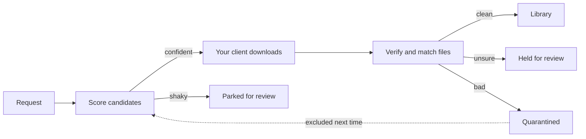

<div align="center">


**Request music. Own everything.**

Self-hosted music requests and discovery with a built-in library and download engine that drives your own clients. No Lidarr. One container.

[](LICENSE)
[](https://github.com/DroppedNeedle/DroppedNeedle)
[](https://hub.docker.com/r/droppedneedle/droppedneedle)
[](https://discord.gg/B5suDg7gu2)
[](https://www.droppedneedle.com/)

[Docs](https://www.droppedneedle.com/) | [Discord](https://discord.gg/B5suDg7gu2) | [Issues](https://github.com/DroppedNeedle/DroppedNeedle/issues) | [Sponsor](https://github.com/sponsors/HabiRabbu)

</div>

---

Search the full MusicBrainz catalogue, request the album or the single track you actually want, and DroppedNeedle takes it from there: it drives your own download client, scores the candidates, verifies every file, and shelves the result in your library. Play it back from Jellyfin, Navidrome, Plex, or local files, or let any Subsonic or Jellyfin app play from you.

> [!NOTE]
> DroppedNeedle only drives a download client you supply and run yourself over its local HTTP API. It never joins a P2P network, ships no indexers, and hosts no audio. What you fetch, and what your client shares back, is your call and your responsibility.

## Contents

- [See it](#see-it)
- [Quick start](#quick-start)
- [What it does](#what-it-does)
- [Download sources](#download-sources)
- [Configuration](#configuration)
- [Users and roles](#users-and-roles)
- [Troubleshooting](#troubleshooting)
- [Guides](#guides)
- [For builders](#for-builders)
- [Support and license](#support-and-license)

---

## See it


<details>
<summary>More screenshots</summary>


</details>

---

## Quick start

You need Docker, a music library, and a download client. The example below uses slskd; [SABnzbd](https://sabnzbd.org/) with Newznab indexers or Prowlarr works too. DroppedNeedle runs neither for you. See [slskd](#slskd) and [Usenet](#usenet).

### 1. Save this compose file

Images live on [Docker Hub](https://hub.docker.com/r/droppedneedle/droppedneedle) as `droppedneedle/droppedneedle:latest`.

```yaml
services:
  droppedneedle:
    image: droppedneedle/droppedneedle:latest
    container_name: droppedneedle
    environment:
      - PUID=1000            # run `id` on your host to find your user/group ID
      - PGID=1000
      - UMASK=027            # secure default; 002 for trusted group-writable media
      - PORT=8688
      - TZ=Etc/UTC           # e.g. Europe/London, America/New_York
      - SLSKD_DOWNLOADS_PATH=/data/slskd/complete
    ports:
      - "8688:8688"
    volumes:
      - ./config:/app/config
      - ./cache:/app/cache
      - ./plugins:/app/plugins  # omit and installed plugins vanish on recreate
      # One shared parent mount keeps the library and completed downloads on one
      # boundary so imports move fast. Do not nest extra binds under /data.
      - /path/to/media:/data:rw
    restart: unless-stopped
```

> [!TIP]
> The full annotated compose, including an optional slskd sidecar, is [docker-compose.example.yml](docker-compose.example.yml).

### 2. Start it

```bash
docker compose up -d
```

Then open [http://localhost:8688](http://localhost:8688).

### 3. First run

1. Create the first admin account. This happens once.
2. Add your library path under Settings > Library, using the in-container path (e.g. `/data/music`).
3. Add your download client under Settings > Download Client, then Test and Save.
4. Hit Scan on Settings > Library. The scan reads and identifies files without renaming or retagging anything.
5. Search the catalogue, open an album, and Request it. Watch it land live on the Downloads page.

Settings > Library won't let you remove your last library path while the library still has tracks in it. Set the path to Excluded instead if you want it left alone. If a path disappears from the settings while its tracks are still in the library, the page offers to put it back.

<details>
<summary>Updating and the dev tag</summary>

Update like any other container:

```bash
docker compose pull
docker compose up -d
```

Before a new version changes the database schema, DroppedNeedle writes a verified backup of the database to `/app/cache/backups`. If an upgrade goes wrong, stop the container, delete `library.db-wal` and `library.db-shm` if they exist, put the backup back in place of `/app/cache/library.db`, copy everything in `/app/cache/backups/undo` into `/app/cache/undo` (files there are named by their content, so a plain copy that skips existing files is safe), and run the previous image. `droppedneedle-tool restore` does both for you. A backup holds your settings too. Stored passwords and API keys in it are sealed with the key file `/app/config/data_enc.key`, so keep that file with your backups. DroppedNeedle refuses to start on a database whose key file is missing or belongs to another database, and changes nothing. If the key is lost for good, `droppedneedle-tool reset-key --yes`, run with the server stopped, makes a new key and clears every stored password, API key, app password and service link, so they can be entered again. It replaces a lost key and does not change the Jellyfin ids of what you already have: stored album and artist ids survive it, and only items added afterwards get ids under the new key. See [docs/upgrading-from-v2.md](docs/upgrading-from-v2.md#backups-and-restore).

Coming from v2? Follow [docs/upgrading-from-v2.md](docs/upgrading-from-v2.md). Stop v2, switch the image tag to v3, and run `docker compose run --rm droppedneedle droppedneedle-tool upgrade` before you start it. It upgrades your data directory in place and keeps your v2 files in a `v2-backup` folder so you can go back. v3 refuses to start on a v2 data directory that has not been upgraded. The guide lists what comes across (accounts, settings, playlists, history, your library with its ids and matches, and the originals of files Library Management changed) and what stays behind.

A `:dev` tag (`droppedneedle/droppedneedle:dev`) is built from `main` on every push that changes the code, and may break. Pin a commit with `:dev-<short-sha>`.

Pre-releases are published to the same image under their own version tag, for example `droppedneedle/droppedneedle:v3.1.0-rc.1`. They never move `:latest`, so you only get one by asking for its tag.

</details>

---

## What it does

| Thing | What you get |
|-|-|
| Request | Whole albums or single tracks from the MusicBrainz catalogue, with an approval queue for the User role |
| Wanted | Failed and partial requests get re-searched on their own until a verified copy shows up |
| Quality | Per-format quality floors, automatic upgrades when a better copy appears, storage caps and quotas |
| Player | Queue, shuffle, 10-band EQ, lyrics from your files (or from LRCLIB when it is on), live now-playing updates |
| Discovery | Trending, charts, genre browsing, recommendations from your ListenBrainz and Last.fm history, an album-by-album discover queue, and a weekly mix that can queue up to five missing albums |
| Live events | Ticketmaster and Skiddle gig alerts for artists you follow, each user with their own cities |
| Following | New-release radar with optional auto-download, release-type filters, and sidebar badges |
| Library | Browse, filter, rate, download, rescan, and remove albums (ratings are shared with Subsonic apps). Search finds your songs as well as artists and albums, and plays a song with one click. Albums DroppedNeedle isn't sure of are listed as unconfirmed, without blocking anything. Admins see artists that appear twice under the same name, or whose songs a tag edit moved to a new name, with the MusicBrainz evidence for each, and can merge them or mark them as different people |
| Drop imports | Drag in a zip or loose files from anywhere you buy music; identified, tagged, and shelved, or held for a manual match |
| Playlists | Mix Jellyfin, Navidrome, Plex, local, YouTube, and Spotify imports in one place, share read-only with one toggle |
| YouTube links | Find an album or its tracks on YouTube from the album page and play them there. Paste your own links on the YouTube library page. Each search spends one unit of the daily quota set under Settings > YouTube; a saved link never searches again |
| Library Management | Optional MusicBrainz Picard-style tags, artwork, and organization behind an admin preview with dry run and typed confirmation. Off until you enable it |

How a request moves:



The engine searches your client, ranks candidates, and auto-accepts a confident match. Close calls park for review instead of guessing.

Which edition a request fetches, how single tracks are found, following artists, and what happens after a download finishes are in [docs/downloads.md](docs/downloads.md).

| Direction | What plugs in |
|-|-|
| In | Your slskd, your SABnzbd with your Newznab indexers or Prowlarr, and drop imports. Identity from MusicBrainz and AcoustID, album art from your files and the Cover Art Archive, artist photos from AudioDB, Deezer and Wikimedia Commons, matched by MusicBrainz id |
| Out | Jellyfin, Navidrome, Plex, local files, and YouTube previews, plus OpenSubsonic and Jellyfin APIs so apps like Symfonium, Finamp, Feishin, Amperfy, Arpeggi, Jellify, and Manet can play from you. The apps get the lyrics your files carry. Albums on Plex and Navidrome whose tags carry no MusicBrainz id are found by title and artist |
| Around | ListenBrainz and Last.fm scrobbling, Spotify playlist import, Ticketmaster and Skiddle gigs, Deezer and iTunes preview clips, and purchase links that put Bandcamp first |

---

## Download sources

A download source is slskd or SABnzbd once it is turned on with a URL and an API key, or an enabled plugin download client (see [PLUGINS.md](PLUGINS.md)). It counts while it is down too: DroppedNeedle keeps retrying it, and the acquisition health check reports it as degraded. Requests, manual search, the health check and Discover's "set up a download client" prompt all go by this one answer.

Request buttons show whether or not a download source is turned on. A request made while none is on is accepted and held. The Requests and Downloads pages show it as "Waiting: no download source configured", and it starts by itself as soon as an admin turns a source on or enables a plugin download client. From then on its card shows what the download is doing: searching, awaiting review or downloading.

The Requests page also lists the downloads that auto-download starts for artists you follow, marked "Followed artist". They count toward your quota like any other request. When your request quota is full, the request still appears and waits as "Waiting: request quota full" ("Waiting: storage full" when your storage budget or the library's size cap is reached), then starts by itself once there is room.

### slskd

DroppedNeedle talks to your own running slskd over its local HTTP API (`X-API-Key`). You bring slskd; DroppedNeedle drives it.

- Use slskd 0.25.0 or newer (0.25.1 is the verified pin: `slskd/slskd:0.25.1`), with a Soulseek account inside it.
- Give DroppedNeedle the URL plus API key under Settings > Download Client, then Test and Save. The key is stored encrypted and never logged.

> [!IMPORTANT]
> Soulseek bans clients that share nothing, so give slskd at least one shared folder or searches and downloads fail. Everything in a shared folder goes out to the network. Choose it like you mean it.

The downloads path is where most installs go wrong. Three rules:

1. Expose slskd's completed-downloads directory to DroppedNeedle read-write under one shared parent mount (e.g. library at `/data/music`, completions at `/data/slskd/complete`).
2. Point `SLSKD_DOWNLOADS_PATH` at that exact directory, not its parent.
3. Skip nested binds under `/data`. Each one is a new mount boundary, which drops imports to the slower copy fallback.

Keep slskd's incomplete directory on the same mount as its downloads directory: slskd can report a transfer Completed before a cross-mount move between the two finishes, so a split mount risks verifying half-copied files.

<details>
<summary>Minimal slskd.yml essentials</summary>

```yaml
soulseek:
  username: your-soulseek-username
  password: your-soulseek-password

shares:
  directories:
    - /data/share   # required: share something or the network bans you

directories:
  downloads: /downloads   # the sidecar path; bind its host dir into DroppedNeedle too

web:
  authentication:
    api_keys:
      droppedneedle:
        key: choose-a-long-random-key
```

</details>

### Usenet

The second source is Usenet through SABnzbd. For searching, either add Newznab-compatible indexers one by one (NZBGeek, NZBPlanet, NZB.su, Slug, and others) or point at a Prowlarr that already has them. The engine searches your chosen side, enqueues NZBs in your SABnzbd, and imports finished files through the same scoring, verification, and quarantine pipeline as slskd.

1. Expose SABnzbd's completed-downloads directory read-write, ideally under the same shared parent mount as the library so the [mount rules](#slskd) hold. In SABnzbd, point its Downloads folder setting at the matching path (e.g. `/data/sabnzbd/complete`).
2. Under Settings > Download Client, enable Usenet and enter your SABnzbd URL and API key.
3. Under Settings > Indexers / Prowlarr, pick one search backend: add each indexer's URL plus API key, or enter your Prowlarr URL plus API key. Then Test and Save.

slskd and Usenet can run side by side; the source priority control picks who goes first.

### Drop imports

Bought music somewhere else? Drop it in. Admins and trusted users can upload up to 25 files at once on the downloads page: audio files, or `.zip` archives straight from the store. Each album is identified, tagged and shelved, or held for a manual match. The details are under [Drop imports](docs/downloads.md#drop-imports).

---

## Configuration

Everything user-editable lives in the web UI and is stored in the database, so a database backup holds it. The config folder holds the key that seals stored secrets. A `config/config.json` from an earlier v3 is copied into the database once, at the first start, and left as it was. You can delete it once you are settled on this version; while it is there, a fresh database beside it would copy it in again. Environment is only for container basics:

| Variable | Default | What it is |
|-|-|-|
| `PUID` | `1000` | File owner inside the container (run `id` on the host) |
| `PGID` | `1000` | File group inside the container |
| `UMASK` | `027` | Creation mask for new files; `002` for trusted group-writable media |
| `PORT` | `8688` | Port the app listens on |
| `BIND_HOST` | `auto` | `auto` listens on IPv4 and IPv6, dropping to IPv4 alone where IPv6 is off. Set `0.0.0.0`, `::`, or one interface IP to pin it |
| `TRUSTED_PROXY_IPS` | `127.0.0.1,::1` | IPs/CIDRs whose `X-Forwarded-*` headers are trusted; point it at your reverse proxy, listing every address family it arrives on. `*` trusts every peer: only behind a proxy that strips spoofed headers |
| `BASE_PATH` | empty | Serve under a sub-path behind a reverse proxy, e.g. `/music`. Letters, digits and `.` `_` `~` `-` only, no trailing slash, and its first segment cannot be `api` |
| `TZ` | `UTC` | Container time zone, as an IANA name such as `Europe/London`. Daily library scans run at their set time in this zone |
| `SLSKD_DOWNLOADS_PATH` | `/data/downloads/slskd` | Exact in-container path to slskd completions (the compose example uses `/data/slskd/complete`) |
| `LOG_LEVEL` | `INFO` | `DEBUG`, `INFO`, `WARNING` or `ERROR` |

The app answers on IPv4 and IPv6, but Docker still has to publish the port on both. `docker port droppedneedle` should list `0.0.0.0:8688` and `[::]:8688`; if only the first appears, turn on IPv6 for the daemon (`"ipv6"` and `"ip6tables"` in `/etc/docker/daemon.json`). Pinning `BIND_HOST` to one interface IP answers only there, but the container `HEALTHCHECK` still uses localhost, so keep a wildcard or loopback value unless you check that address yourself.

Behind a reverse proxy, list the proxy in `TRUSTED_PROXY_IPS` and have it pass `Host` and `X-Forwarded-Proto` through. Serve DroppedNeedle over HTTPS through the proxy if you can. Browsers use HTTP/2 only over HTTPS, and HTTP/2 loads cover grids faster than plain HTTP, where six connections per host can all be busy with slow covers. The proxy headers, `BASE_PATH`, the public address, HSTS and the content-security policy are covered in [docs/reverse-proxy-and-security.md](docs/reverse-proxy-and-security.md).

<details>
<summary>Rarely needed variables</summary>

| Variable | Default | What it is |
|-|-|-|
| `CONTACT_EMAIL` | `contact@droppedneedle.com` | Contact address in the outbound User-Agent; MusicBrainz asks for one, so set your own if you run many lookups |
| `DISCOVER_WARMER_ENABLED` | `true` | Keeps each user's Discover page and discover queue fresh in the background while they use them. `false` builds them only when someone opens the page |
| `SHUTDOWN_GRACE_PERIOD` | `10` | Seconds to finish open requests and stop background work on shutdown |
| `HTTP_TIMEOUT` | `30` | Outbound request timeout, seconds |
| `HTTP_CONNECT_TIMEOUT` | `10` | Outbound connect timeout, seconds |
| `HTTP_MAX_KEEPALIVE` | `50` | Idle outbound connections kept per host |
| `RUST_LOG` | unset | Full log filter (e.g. `info,droppedneedle_library=debug`, or `droppedneedle_auth=debug` for sign-in); wins over `LOG_LEVEL` |
| `ROOT_APP_DIR` | `/app` | Base for the paths below and for `/app/plugins` and `/app/imports` |
| `CACHE_DIR` | `/app/cache` | Database, backups, served web UI, caches |
| `COVER_CACHE_MAX_SIZE_MB` | `500` | Size cap for downloaded and extracted cover art under `CACHE_DIR/covers`; the least recently shown covers go first |
| `LIBRARY_DB_PATH` | `/app/cache/library.db` | The database file; backups go in `backups/` and Undo's saved copies in `undo/` next to it |
| `CONFIG_DIR` | `/app/config` | Holds `data_enc.key`, the key that seals stored secrets. Replaces `CONFIG_FILE_PATH`, which now stops the start: set `CONFIG_DIR` to that file's folder |
| `DROPPEDNEEDLE_STATIC_DIR` | `/app/static` | The web UI build shipped in the image |

</details>

<details>
<summary>Permissions and NAS notes</summary>

Keep `027` for a private box. Use `002` when DroppedNeedle and another trusted service in the same group both write the same media. Skip `000`: it makes new files writable by every local account the filesystem allows. `UMASK` shapes new files only; a move can keep the source mode the download client set.

Unraid commonly uses `nobody:users` (PUID 99, PGID 100). Point PUID and PGID at whoever owns the mounted config and cache paths. The container skips ownership changes it cannot make, which covers FUSE, NFS, CIFS, and rootless setups. A read-only config or cache mount refuses to start before anything gets written.

`/app/config` and `/app/cache` must be writable and honor SQLite locking, `fsync`, and atomic replacement. Plain bind mounts, named volumes, local Unraid shares, and TrueNAS datasets with normal permissions all qualify. NFS and SMB mounts only work when they support the same file locking SQLite needs. If `/app/cache` is on a network or FUSE mount, or is a symlink, `metadata-cache.db` is kept beside the database instead; if that place is refused too, provider answers are fetched each time and the server log says the provider cache is off. On Docker Desktop for Windows, prefer named volumes for those two paths.

</details>

| Data | Container path | Notes |
|-|-|-|
| Settings and encryption key | `/app/config` | Persist it |
| Database, backups, cover art and metadata cache | `/app/cache` | Persist it. The `undo` folder beside `library.db` holds the tags, pictures and files Undo and "Restore originals" put back; backups copy it into `backups/undo`, so keep the whole `backups` folder. Provider answers (MusicBrainz, Last.fm and the like) live in `metadata-cache.db`, which survives a restart, is not in the backups, and can be deleted safely while the server is stopped |
| Plugins | `/app/plugins` | Persist it or installs vanish on recreate |
| Download and drop-import staging | `/app/imports` | Optional; without it, staged downloads, large uploads and unmatched files live on the container layer |
| Media | `/data` | Shared parent for library (`/data/music`) and client completions |

Where things live in the UI:

| Setting | Location |
|-|-|
| Library paths, import naming script, scan schedule, AcoustID key | Settings > Library |
| Library Management profiles, previews, recovery | Library Management (admin) |
| Download clients (slskd, SABnzbd), source priority, quality tiers, picking a copy, wanted watcher | Settings > Download Client |
| Newznab indexers or Prowlarr | Settings > Indexers / Prowlarr |
| Edition preferences, managing unconfirmed matches | Settings > Editions |
| Lidarr import | Settings > Lidarr Import |
| Subsonic and Jellyfin APIs, app passwords, transcoding | Settings > Connect Apps |
| Jellyfin | Settings > Jellyfin |
| Navidrome | Settings > Navidrome |
| Plex | Settings > Plex |
| Local files (the built-in library) | Settings > Library |
| Last.fm app key (admin, once per instance) | Settings > Last.fm |
| YouTube API key | Settings > YouTube |
| Spotify client ID and secret | Settings > Spotify |
| Ticketmaster and Skiddle keys, sweep scope | Settings > Live Events |
| ListenBrainz connection for scrobbling (admin) | Settings > ListenBrainz |
| Buy links | Settings > Get it |
| Scrobbling and discovery accounts | Profile > Scrobbling & Discovery |
| Release types | Settings > Release Types |
| Home layout | Settings > Home |
| Discover page sections, the discover queue | Settings > Discover |
| Sidebar | Settings > Sidebar |
| Main listening source (ListenBrainz or Last.fm) | Settings > Music Source |
| MusicBrainz server (official or your own mirror) | Settings > MusicBrainz |
| Users, roles, Jellyfin and Plex user import | Settings > Users |
| Password breach checking, HSTS, the content-security policy, single sign-on (OIDC), who can download library files | Settings > Security |
| Plugins | Settings > Plugins |
| Library images, cache counts and clearing | Settings > Cache |
| Wrapped API | Settings > Wrapped API |
| Outbound provider calls, rate limits and background jobs | Settings > Diagnostics |
| Discover queue and top picks tuning | Settings > Advanced |

---

## Users and roles

| Role | Requests | Admin |
|-|-|-|
| Admin | Requests start immediately, no approval | Everything: users, approvals, all settings |
| Trusted | Requests start immediately, no approval | Nothing admin side |
| User | Requests wait for admin approval | Nothing admin side |

The first account is always admin. Later accounts are created by an admin or automatically on first Jellyfin, Plex, or OIDC sign-in (all start as User). Every login method toggles in the UI; no environment variables involved. Sessions last 30 days and die with the account if an admin deletes it.

Forgot a password? An admin makes a one-time recovery code for the account under Settings > Users, and "Forgot password?" on the sign-in page takes it. If no admin can sign in either (for example single sign-on stopped working), make the code on the host. Stop the server first, because the command refuses to run while it is up:

```bash
docker compose stop droppedneedle
docker compose run --rm droppedneedle droppedneedle-tool recovery-code USERNAME
docker compose up -d droppedneedle
```

`droppedneedle` is the service name in your compose file; use yours if it differs. The code works once, for 15 minutes. `USERNAME` is the DroppedNeedle username, which can differ from the name the account has with an OIDC provider; `droppedneedle-tool recovery-code --list-admins` prints the admin usernames. An account that only signs in through OIDC, Plex or Jellyfin gets its first password this way and keeps its other sign-in. Only the host command can do that: a code made by an admin under Settings > Users is for accounts that already have a password. It is still simpler to keep one admin with a username and password.

<details>
<summary>Setting up OIDC</summary>

Any OpenID Connect provider works (Authelia, Keycloak, Authentik, Pocket ID, and others):

1. In your provider, create a client for DroppedNeedle. Set its redirect URI to `https://your-droppedneedle-url/api/v3/auth/oidc/callback`. If you serve DroppedNeedle under a sub-path with `BASE_PATH`, put that in front: `https://example.com/music/api/v3/auth/oidc/callback`.
2. Under Settings > Security, enter the issuer URL, the client ID, the client secret (leave it empty for a public client), and the same redirect URI. Keep `openid` in the scopes; `openid email profile` is the default.
3. Test, switch it on and save. A single sign-on button appears on the login page.

Things worth knowing:

- Use https for the provider. Plain http only works when the provider runs on the same machine or on your local network (a 10.x, 172.16-31.x, 192.168.x, 100.64-127.x or IPv6 local address, or `localhost`), and that applies to every address in its discovery document too. A v2 setup that used plain http to a public address stops working until you switch the provider to https; the server log and the Test button say so. DroppedNeedle also does not follow redirects from the provider, so enter its final URL.
- The issuer URL is the one your provider lists as `issuer` at `/.well-known/openid-configuration`. DroppedNeedle checks that the two match and refuses to log in if they don't.
- DroppedNeedle checks the signature, audience, expiry and nonce of every login token against the keys your provider publishes, so the server needs to reach your provider directly, not only your browser.
- A sign-in only joins an existing DroppedNeedle account when the provider says the email address is verified. Otherwise it creates a new account.
- The first account on a fresh install becomes the admin, whichever way it signs in.
- Coming from v2? The old callback, `/api/v1/auth/oidc/callback`, still works, so the provider needs no change after the upgrade.

</details>

<details>
<summary>Signing in with Plex or Jellyfin</summary>

Turn on "Allow login with Plex" or "Allow login with Jellyfin" on that server's settings page. The login page then shows the matching tab, and the sign-in only works while the switch is on.

- Jellyfin checks the username and password against your Jellyfin server.
- Plex sends the user to plex.tv to approve the sign-in. When a Plex server is set up, only accounts that can reach that server get in, and if DroppedNeedle cannot reach the server to check, nobody gets in until it can.
- The check uses the Plex URL on the Plex settings page even while the Plex integration itself is switched off. Clear the URL if you want Plex login without the server check.
- Careful: with "Allow login with Plex" on and no Plex server set up, anyone with a plex.tv account can create an account on your DroppedNeedle. Set up the server first, or keep the switch off.

Either way the user's own media account is linked for playback, so plays count for them without extra setup. Admins can also pre-create accounts for everyone on the media server from Settings > Users > Import; those people then sign in with Plex or Jellyfin and land in their account.

</details>

---

## Troubleshooting

- Downloads finish in the client but never import: `SLSKD_DOWNLOADS_PATH` must point at the exact completions directory, visible read-write. The Download Client page shows the path status and the reason. Every few minutes DroppedNeedle also checks whether slskd's finished downloads can actually be found in that folder, and if they can't, the page says why: the folder looks empty, or it holds other files (usually because the mount is a parent folder such as your whole media share). It also shows where slskd itself saves, so you can line the two up. A wrong path is usually fixed with the downloads subfolder box on that page.
- Separate-mount warning: imports still work through copy-and-remove, which briefly needs room for both copies. One shared `/data` parent with no nested binds restores fast moves.
- Client connection fails or returns 401: wrong URL or API key. Re-enter both under Settings > Download Client and Test.
- Searches return nothing or the network drops you: slskd needs shared folders and a healthy Soulseek connection. Leechers get banned.
- Scan finds nothing or files pile into manual review: check the library path is readable. Untagged files with no fingerprint match need a human.
- Now playing, scan progress and "download started" pop-ups only change when you reload: each open tab keeps one long-lived connection to `/api/v3/events/stream` for live updates, and something in between is holding it back. Behind nginx, add `proxy_buffering off;` and `proxy_read_timeout 1h;` for that path (the app already sends `X-Accel-Buffering: no`). Other proxies have a similar "don't buffer" switch. Don't let the proxy compress `text/event-stream` either.
- Signed in, but every save answers `403 Origin not allowed`: that is the reverse proxy, not the account. See [Public address](docs/reverse-proxy-and-security.md#public-address), which ends with `droppedneedle-tool public-address`, the host command for it.
- The web UI is a blank page and the browser console names the content-security policy: usually a reverse proxy that rewrites the page or injects a script, such as Cloudflare's Rocket Loader. Turn that off for DroppedNeedle, or switch the policy to report-only from the host: see [Content-security policy](docs/reverse-proxy-and-security.md#content-security-policy).

---

## Guides

- [Your library](docs/library.md): scans, identification, unconfirmed matches, album organization, removing and downloading albums, lyrics, ratings, adding a missing album to MusicBrainz.
- [Library Management](docs/library-management.md): profiles, tags, artwork, lyrics, previews and Apply, Undo, editions, hand edits and retags.
- [Requests and downloads](docs/downloads.md): editions and single tracks, following artists, held files, upgrades, choosing a copy, drop imports.
- [Discovery, apps and accounts](docs/discovery.md): Home, Discover, radio, Weekly Mix, covers, Last.fm, ListenBrainz, Spotify and music apps.
- [Reverse proxy and security](docs/reverse-proxy-and-security.md): proxy headers, base path, public address, HSTS, content-security policy.
- [Upgrading from v2](docs/upgrading-from-v2.md).
- [MusicBrainz sources and self-hosted mirrors](docs/musicbrainz-mirror-selfhosting.md).

---

## For builders

The OpenAPI document is served at `/openapi.json` on your instance. Every `/api/v3/*` route takes a Bearer token or the session cookie, everything under `/api/v3/settings/*` also needs Admin, and `/health` stays public for the container check.

Plugins work like community plugins in Lidarr: paste a GitHub repository URL in Settings > Plugins, check what it asks to do, and install it, pinned to an exact commit. Each enabled plugin runs as its own process, so a crash or a hang stays with that plugin; it gets a clean environment, its own folder and a memory cap. It is still trusted code with your server's file and network access, not a sandbox, so only install plugins you trust. Python plugins work out of the box in the Docker image. v2 plugins do not load as they are: they port with an import change and `api_version = 2`. Nothing is bundled. Files a plugin adds to your library are listed on its card, where an admin can undo each one. Reference: [PLUGINS.md](PLUGINS.md). Walkthrough: [docs/PLUGIN-CREATION.md](docs/PLUGIN-CREATION.md).

Bug reports and feature requests go to [Issues](https://github.com/DroppedNeedle/DroppedNeedle/issues), code via PRs. Dev setup, tests, and style rules are in [CONTRIBUTING.md](CONTRIBUTING.md).

---

## Support and license

Docs: [droppedneedle.com](https://www.droppedneedle.com/). Chat: [Discord](https://discord.gg/B5suDg7gu2). Bugs and ideas: [GitHub Issues](https://github.com/DroppedNeedle/DroppedNeedle/issues).

<div align="center">

[](https://ko-fi.com/M4M41URGJO)
[](https://github.com/sponsors/HabiRabbu)

If DroppedNeedle earns its keep, fuel it. Monthly or one-off, both welcome.

</div>

DroppedNeedle is [AGPL-3.0](LICENSE). Copyright (c) 2025 DroppedNeedle and contributors. For commercial licensing, write to contact@droppedneedle.com.
